# video-refresh-benchmark

**Author: Siyu Han**

A reproducible benchmark comparing sequential video decoding, dense RGB feature extraction, and periodic RGB feature caching.

**Research question:** If RGB features are computed at only one-quarter of the candidate positions and cached features are reused elsewhere, how much does encoded-clip-to-features latency decrease?

**Status: preliminary feasibility benchmark.** The October 10 RGB pilot and an October 12 codec-vector CPU overhead follow-up have completed CUDA measurements on ten low-resolution Kinetics validation clips. Periodic processing was faster by median latency in every clip in both experiments. Drift-prediction diagnostics are complete for the ten-video pilot and a separate 200-video subset. Fixed-budget adaptive policies have offline feature-fidelity replay and an inconclusive fresh-video confirmation. A separate lightweight classification-head experiment now measures task-aware hindsight headroom. Recognition preservation in a deployed adaptive system, a learned motion branch, actual adaptive-policy execution performance, and higher-resolution performance remain unevaluated.

## What the three modes do

Every mode sequentially decodes the **entire encoded video**, including frames between candidates and after the last refresh. There is no seeking, skipped-frame decoding, or reuse of previously decoded frames. Inspection selects 16 distinct approximately uniform zero-based decoded-frame indices, including the first and last frames.

| Mode | Work at candidate positions | Encoder calls | Cache reuses | Feature outputs |
| --- | --- | ---: | ---: | ---: |
| `decode` | Decode only; no RGB conversion or appearance encoder | 0 | 0 | 0 |
| `dense` | Convert to RGB, preprocess, transfer to CUDA, and encode every candidate | 16 | 0 | 16 |
| `periodic` | Refresh at candidate ordinals 0, 4, 8, and 12; reuse the latest feature elsewhere | 4 | 12 | 16 |

Candidate ordinals are positions in the saved candidate list, not raw video-frame indices. The periodic cache starts empty for every video and every trial. A reused output is the same most recently refreshed feature, not a newly computed feature for that frame.

The encoder is torchvision's pretrained **ResNet18_Weights.DEFAULT**, with its classification layer replaced by `torch.nn.Identity()`. Each encoder call produces a `[1, 512]` float32 feature. ResNet18 is an **appearance-feature timing prototype**, using batch size 1, CUDA, `model.eval()`, and `torch.inference_mode()`; it is not an evaluated action-recognition system. The weights' [documented preprocessing](https://docs.pytorch.org/vision/stable/models/generated/torchvision.models.resnet18.html) resizes the shorter edge to 256 with bilinear interpolation, center-crops to 224, rescales to [0,1], and applies ImageNet normalization. RGB conversion and preprocessing run only at refreshes.

## Published pilot: 2026-10-10

The curated [public results snapshot](results/pilot_2026_10_10/README.md) contains **10 videos and 150 measured trials**: ten videos × three modes × five repetitions. A preceding single-video check contains 15 trials. Videos are H.264, 7.600–10.022 seconds long, with 228–600 decoded frames and resolutions 256×452, 454×256, or 412×256.

The values below were verified directly against the saved trial CSV. They are descriptive pilot results for this dataset and machine.

| Video | Decode median (ms) | Dense median (ms) | Periodic median (ms) | Speedup | Reduction |
| --- | ---: | ---: | ---: | ---: | ---: |
| 0pVGiAU6XEA | 109.10 | 231.45 | 142.71 | 1.622x | 38.34% |
| AQrbRSnRt8M | 172.92 | 307.24 | 201.11 | 1.528x | 34.55% |
| IcLztCtvhb8 | 162.95 | 302.87 | 197.07 | 1.537x | 34.93% |
| SU_x2LQqSLs | 115.53 | 247.01 | 147.70 | 1.672x | 40.21% |
| b6Q_b7vgc7Q | 192.20 | 321.20 | 223.26 | 1.439x | 30.49% |
| ddvJ6-faICE | 84.42 | 210.36 | 114.57 | 1.836x | 45.54% |
| ik4BW3-SCts | 138.99 | 272.47 | 171.06 | 1.593x | 37.22% |
| jqRrH30V0k4 | 290.82 | 414.24 | 341.68 | 1.212x | 17.52% |
| u4Rm6srmIS8 | 160.84 | 293.10 | 195.14 | 1.502x | 33.42% |
| y5Iu7XkTqV0 | 169.15 | 276.36 | 211.02 | 1.310x | 23.64% |

For each video `i`, first calculate:

```text
speedup_i = median(dense trials_i) / median(periodic trials_i)
reduction_i (%) = 100 * (median(dense trials_i) - median(periodic trials_i)) / median(dense trials_i)
```

Then summarize those ten per-video statistics with equal weight per video:

- **Median per-video latency reduction: 34.74%.**
- **Median per-video speedup: 1.532×.**
- **Per-video reduction range: 17.52–45.54%.**
- Median latency was lower with periodic processing in **10/10 videos**.

The median across the ten video-level latency medians is 161.89 ms for decode only, 284.73 ms for dense, and 196.10 ms for periodic. Dividing the last two aggregate medians gives approximately **1.452×**, a different calculation from the **1.532× median of per-video speedups**. The headline statistics are calculated per video before aggregation.

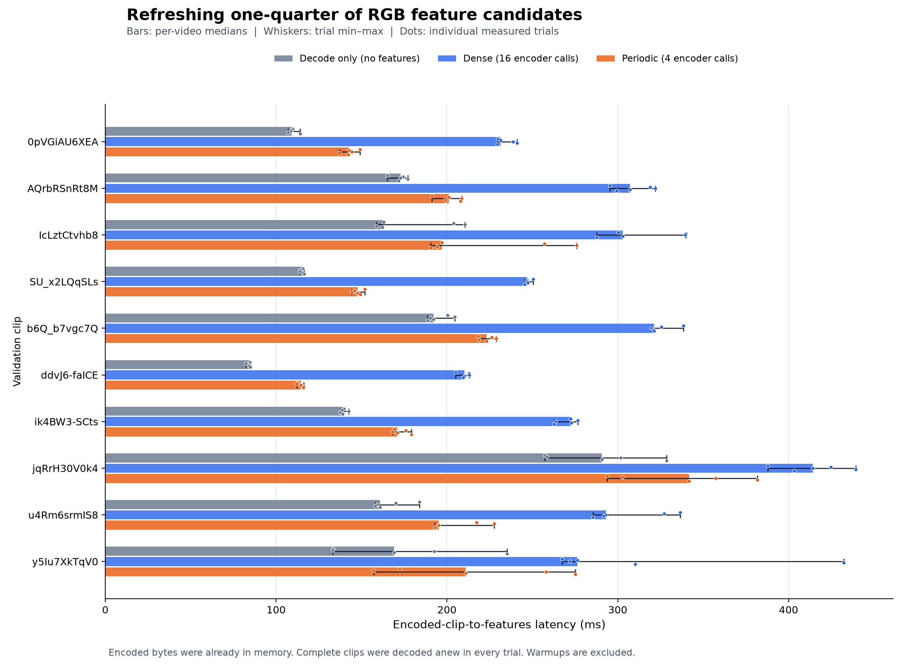

Bars show per-video medians; whiskers show trial minimum–maximum; dots show individual trials. Nine videos had non-overlapping observed dense/periodic trial ranges. For `y5Iu7XkTqV0`, the ranges overlapped and the reduction differed between the initial single-video run and the ten-video pilot. Five repeats describe exploratory variability, not confidence intervals or statistical significance.

**Decode-only is a separate baseline with no feature outputs.** It is not assumed to be an exact additive component and is not subtracted from another mode to estimate isolated encoder time. Full decoding remains necessary even when encoder calls fall by 75%.

See the [raw trials](results/pilot_2026_10_10/pilot.csv), [summary](results/pilot_2026_10_10/summary.csv), and [findings](results/pilot_2026_10_10/findings.md).

## Measurement boundary and controls

The metric is **Encoded-clip-to-features latency (ms)**: encoded video bytes already in memory through completed feature outputs. For every timed trial:

1. Synchronize CUDA, then start `time.perf_counter()`.
2. Open a fresh PyAV container over a fresh `io.BytesIO(encoded_bytes)`.
3. Sequentially decode the complete video and execute the selected mode.
4. Close the container, synchronize CUDA, then stop the timer.

The boundary includes container opening/closing, demuxing/decoding, required RGB conversion and preprocessing, CPU-to-GPU transfer, encoder execution, and feature-output/cache handling. Feature outputs remain on the GPU until timing finishes. No decoded frames, preprocessed tensors, or features survive from an earlier trial.

Dataset downloading/extraction, file loading, inspection, model construction/weight download, correctness checks, logging, and CSV writing are excluded. Encoded-file loading is recorded separately for each video and its bytes are reused across that video's trials. Model weights are prepared before timing.

- **Warmups:** two complete trials per mode per video, excluded from CSV rows.
- **Measurements:** five repetitions per mode per video; shuffle the three modes within each repetition using seed **20261010**. Actual execution order is recorded in the metadata sidecar.
- **Decoder:** software decoding, `thread_count=1`, `thread_type=NONE`, `skip_frame=NONE`, identical across modes.
- **Numerics:** float32, batch size 1, deterministic algorithms enabled; TF32 and autocast disabled; cuDNN benchmark disabled. PyTorch CPU and interop thread counts are 1. No compiled model is used.
- **Execution:** videos and trials run sequentially in one process. CUDA synchronization occurs at both timer boundaries. Feature validation and counter checks occur outside timed regions.

The [run metadata](results/pilot_2026_10_10/pilot.metadata.json) records inputs, candidate indices, file-loading times, settings, execution order, weight hash, original measurement-source hashes, and environment. Reproducible inputs and settings do not guarantee identical wall-clock timings on a laptop with changing scheduling or power state.

## Tested hardware and software

| Component | Tested value |
| --- | --- |
| OS | Windows 11 Home Chinese, x64; build 22631 |
| CPU | Intel Core i7-10870H @ 2.20 GHz; 8 cores / 16 logical processors |
| GPU | NVIDIA GeForce RTX 3080 Laptop GPU; 16 GiB VRAM |
| NVIDIA driver | **610.62** |
| Driver-reported CUDA support | 13.3 (`nvidia-smi` CUDA UMD Version) |
| PyTorch CUDA build | **13.2**, from `torch.version.cuda` (`cu132`) |
| Python | 3.12.10, 64-bit |
| PyTorch | 2.14.1+cu132 |
| torchvision | 0.29.1+cu132 |
| PyAV | 19.0.1 |
| FFmpeg linked by PyAV | 9.0.2 |
| NumPy / pandas | 2.5.2 / 3.0.6 |
| matplotlib / Pillow | 3.11.2 / 12.3.0 |

The **NVIDIA driver version** and **PyTorch CUDA build version** are different quantities. The driver must support the selected runtime; their version numbers need not match. The tested driver supports the cu132 build. See [NVIDIA's compatibility documentation](https://docs.nvidia.com/deploy/cuda-compatibility/why-cuda-compatibility.html).

The sanitized [environment record](results/pilot_2026_10_10/environment.json) includes each linked FFmpeg library version and successful GPU checks. The [exact tested requirements](results/pilot_2026_10_10/requirements-tested.txt) retain all installed package versions. Personal installation paths and unnecessary user/host information are omitted from public copies.

## Installation

All PowerShell commands below run from the **repository root**, the folder containing `benchmark.py`. The checkout folder may have any name. The commands use `.venv` directly and do not require activation. Windows x64 with Python 3.12 and an NVIDIA GPU is the tested setup; other platforms and driver/build combinations require their own validation.

### 1. Create the project environment

```powershell
py -3.12 -m venv .venv
& .\.venv\Scripts\python.exe -m pip install --upgrade --only-binary=:all: pip
```

### 2. Install CUDA-enabled PyTorch separately

Use the [official PyTorch installation selector](https://pytorch.org/get-started/locally/) to choose a CUDA wheel family compatible with your NVIDIA driver, and install matching torch/torchvision builds together. For the exact tested cu132 setup:

```powershell
nvidia-smi
& .\.venv\Scripts\python.exe -m pip install --only-binary=:all: 'torch==2.14.1+cu132' 'torchvision==0.29.1+cu132' --index-url https://download.pytorch.org/whl/cu132
```

The same tested command is provided by `requirements-cuda.txt`:

```powershell
& .\.venv\Scripts\python.exe -m pip install -r .\requirements-cuda.txt
```

Run either CUDA installation command. If your driver cannot support this build, choose a supported build from the selector and record that environment for new results. The prebuilt wheels provide the CUDA runtime libraries used by this project; a separate CUDA Toolkit is not needed for these checks.

### 3. Install the remaining dependencies and check CUDA

```powershell
& .\.venv\Scripts\python.exe -m pip install -r .\requirements.txt
& .\.venv\Scripts\python.exe -m pip check
& .\.venv\Scripts\python.exe .\check_env.py
if ($LASTEXITCODE -ne 0) { throw 'Resolve the environment diagnosis before GPU timing.' }
```

`requirements.txt` contains tested, index-resolvable non-PyTorch dependencies with no local `file://` paths. `check_env.py` prints and saves Python/package/FFmpeg versions, CPU/GPU/driver details, CUDA availability, and a small GPU calculation. CUDA must pass before reporting GPU timings. The benchmark can run CPU correctness checks if CUDA is unavailable, but it does not silently substitute CPU latency measurements.

## Reproduce a new experiment

New outputs below go under `results/repro/`, separate from the frozen public snapshot. Downloaded videos, archives, model weights, local diagnostics, and new results are ignored by Git.

### 1. Prepare the dataset

```powershell
& .\.venv\Scripts\python.exe .\prepare_data.py
if ($LASTEXITCODE -ne 0) { throw 'Dataset preparation failed.' }
```

This downloads [OpenMMLab's kinetics400_tiny.zip](https://download.openmmlab.com/mmaction/kinetics400_tiny.zip) into `data/source/`, validates and reuses an existing valid archive, extracts it there, preserves source annotation files, and copies its ten validation MP4s into `data/videos/`. Original names and encoded bytes are preserved. The source URL, selected paths, and SHA-256 hashes are recorded in the manifest. No MMAction2 installation is required. Existing conflicting files are preserved and reported as errors.

### 2. Inspect the first clip, then the remaining nine

```powershell
& .\.venv\Scripts\python.exe .\inspect_video.py --input data/videos/y5Iu7XkTqV0.mp4
if ($LASTEXITCODE -ne 0) { throw 'First-video inspection failed.' }
& .\.venv\Scripts\python.exe .\inspect_video.py --input data/videos --skip-existing
if ($LASTEXITCODE -ne 0) { throw 'Remaining inspections failed.' }
```

Inspection fully decodes each clip, counts actual frames and picture types, determines duration, and writes 16 distinct candidate indices to `results/manifest.json`. It rejects fewer than 16 decoded frames or duration outside 5–15 seconds. Entries are keyed by relative path and retain file hashes, sizes, and timestamps to detect changes. Frames are discarded after inspection; benchmark trials decode again. Directory inputs use selected manifest paths, excluding unrelated MP4s. Reinspect after moving/replacing a video: the original machine's modification timestamps are not portable input identity for a new run.

### 3. Verify one video

```powershell
& .\.venv\Scripts\python.exe .\benchmark.py --input data/videos/y5Iu7XkTqV0.mp4 --modes decode dense periodic --candidates 16 --refresh-every 4 --device cuda --verify-only --output results/repro/single_video.csv
if ($LASTEXITCODE -ne 0) { throw 'Correctness failed; stop before timing.' }
```

Verification exercises two fresh trials per mode. It checks decoded-frame counts, encoder/cache/output counters, feature shape and finite values, refreshed-feature agreement with dense outputs, reused-feature equality, first-candidate refresh, and cache isolation across trials/videos. The initial clip decoded to 300 frames; its expected rows are `decode: 300/0/0/0`, `dense: 300/16/0/16`, and `periodic: 300/4/12/16` (frames/calls/reuses/outputs). `--verify-only` writes a verification JSON, not a measured CSV.

### 4. Run the single-video timing check

```powershell
& .\.venv\Scripts\python.exe .\benchmark.py --input data/videos/y5Iu7XkTqV0.mp4 --modes decode dense periodic --candidates 16 --refresh-every 4 --warmup 2 --repeats 5 --device cuda --output results/repro/single_video.csv
if ($LASTEXITCODE -ne 0) { throw 'Single-video timing failed.' }
if ((Import-Csv .\results\repro\single_video.csv).Count -ne 15) { throw 'Expected 15 measured rows.' }
```

### 5. Verify all ten, then measure all ten

```powershell
& .\.venv\Scripts\python.exe .\benchmark.py --input data/videos --modes decode dense periodic --candidates 16 --refresh-every 4 --device cuda --verify-only --output results/repro/pilot.csv
if ($LASTEXITCODE -ne 0) { throw 'Ten-video verification failed.' }
& .\.venv\Scripts\python.exe .\benchmark.py --input data/videos --modes decode dense periodic --candidates 16 --refresh-every 4 --warmup 2 --repeats 5 --device cuda --output results/repro/pilot.csv
if ($LASTEXITCODE -ne 0) { throw 'Ten-video timing failed.' }
if ((Import-Csv .\results\repro\pilot.csv).Count -ne 150) { throw 'Expected 150 measured rows.' }
```

Timing invocations repeat correctness verification before their warmups. Every trial's counters are checked outside timing. Add `--seed INTEGER` to change the default order seed and record it in the run metadata.

### 6. Summarize new measurements

```powershell
& .\.venv\Scripts\python.exe .\summarize.py --input results/repro/pilot.csv --output results/repro/summary.csv
if ($LASTEXITCODE -ne 0) { throw 'Result validation or summary failed.' }
```

The summary validates frame counts, counters, row counts, and recorded execution order. It writes per-video median/min/max latencies, speedups, reductions, a variability plot, aggregate statistics, and findings. Negative reductions are preserved. A manifest beside the input CSV is used when present; otherwise the live `results/manifest.json` is used. `--manifest FILE` selects one explicitly.

## Recompute the published summary without downloading videos

After installing the packages, the frozen snapshot can be analyzed without the local dataset, CUDA availability, or downloaded model weights:

```powershell
& .\.venv\Scripts\python.exe .\summarize.py --input results/pilot_2026_10_10/pilot.csv --output results/recomputed_pilot_2026_10_10/summary.csv
& .\.venv\Scripts\python.exe .\validate_release.py
```

The adjacent snapshot manifest and metadata provide the saved input identity/settings. The release validator checks raw counters, reported statistics, snapshot checksums, source hashes for the unchanged benchmark, and relative documentation links. It does not run a new GPU timing experiment. Do not write recomputed output into the frozen snapshot.

## Follow-up: codec motion-vector overhead

**Research question:** How much time remains saved by periodic RGB refresh when dense and periodic pipelines also export codec motion vectors and compute simple CPU motion descriptors?

The [motion experiment snapshot](results/motion_overhead_2026_10_11/README.md) uses the same ten encoded files, candidates, ResNet18 weights/preprocessing, numerical settings, and decoder threads. The folder name is the requested experiment label; actual collection timestamps are recorded in metadata. The three RGB controls are **rerun in this session** by calling the unchanged `benchmark.process_clip`; October 10 timings are not substitutes. The October 10 snapshot and its measurement sources remain unchanged.

| Condition | RGB calls / reuses / outputs | CPU motion descriptor updates |
| --- | --- | --- |
| `decode` | 0 / 0 / 0 | 0 |
| `dense` | 16 / 0 / 16 | 0 |
| `periodic` | 4 / 12 / 16 | 0 |
| `decode_mv` | 0 / 0 / 0 | One per decoded frame |
| `dense_mv` | 16 / 0 / 16 | One per decoded frame |
| `periodic_mv` | 4 / 12 / 16 | One per decoded frame, including RGB cache reuses |

All conditions fully decode every frame. `_mv` conditions set `stream.codec_context.options['flags2'] = '+export_mvs'` before the decoder opens and access `frame.side_data.get('MOTION_VECTORS').to_ndarray()`. This API was checked against the installed PyAV version and real decoder output. See [PyAV side data](https://pyav.basswood.io/docs/develop/api/sidedata.html), the [FFmpeg extraction example](https://www.ffmpeg.org/doxygen/9.0/extract__mvs_8c_source.html), and [AVMotionVector fields](https://www.ffmpeg.org/doxygen/9.0/structAVMotionVector.html).

For each exported entry, convert `motion_x`, `motion_y`, and `motion_scale` to float64 before division, then calculate `dx = motion_x / motion_scale`, `dy = motion_y / motion_scale`, and `numpy.hypot(dx, dy)`. Each frame's descriptor contains vector count, unweighted mean magnitude, and `numpy.percentile(magnitude, 90, method='linear')`, in codec-displacement pixels. Missing vectors give zeros with `mv_available=false`; observed zero displacement retains `mv_available=true`. Invalid scales or malformed fields raise a video/frame-specific error. Reference directions use `source<0` for past, `source>0` for future, and zero for other.

Each `_mv` mode retains the same fresh frozen CPU descriptor objects in a list until timing ends. There is no motion GPU transfer or learned motion encoder. Appearance features stay on CUDA until timing ends. Every trial uses a fresh container and resets all caches; neither frames nor raw vector arrays survive into later trials.

The boundary remains **encoded bytes already in memory through completed outputs**, with CUDA synchronization at both timer boundaries. Export configuration, export/access/conversion, CPU summaries, and descriptor retention are included. Inspection, file loading, verification, model preparation, CSV writing, and plotting are excluded. Each video gets two complete warmups per mode and five measured repeats per mode, with all six modes shuffled within each repeat using seed **20261011**, sequentially in one process. Metadata records actual order, loading times, source/video/weight hashes, environment, and GPU telemetry. Packages are recorded from the existing environment without upgrading them.

From the repository root, after dataset preparation and ordinary video inspection, run these PowerShell commands. To keep a published snapshot frozen when repeating the experiment, change all output paths to a fresh results directory.

```powershell
& .\.venv\Scripts\python.exe .\inspect_motion.py --input data/videos/y5Iu7XkTqV0.mp4 --output results/motion_overhead_2026_10_11/single_video_motion.csv
if ($LASTEXITCODE -ne 0) { throw 'Motion export inspection failed.' }
& .\.venv\Scripts\python.exe .\benchmark_motion.py --input data/videos/y5Iu7XkTqV0.mp4 --modes decode dense periodic decode_mv dense_mv periodic_mv --candidates 16 --refresh-every 4 --device cuda --verify-only
if ($LASTEXITCODE -ne 0) { throw 'Single-video correctness failed.' }
& .\.venv\Scripts\python.exe .\benchmark_motion.py --input data/videos/y5Iu7XkTqV0.mp4 --modes decode dense periodic decode_mv dense_mv periodic_mv --candidates 16 --refresh-every 4 --warmup 2 --repeats 5 --device cuda --output results/motion_overhead_2026_10_11/single_video.csv
if ($LASTEXITCODE -ne 0) { throw 'Single-video timing failed.' }
if ((Import-Csv .\results\motion_overhead_2026_10_11\single_video.csv).Count -ne 30) { throw 'Expected 30 measured rows.' }
```

```powershell
& .\.venv\Scripts\python.exe .\inspect_motion.py --input data/videos --output results/motion_overhead_2026_10_11/all_video_motion.csv
if ($LASTEXITCODE -ne 0) { throw 'Dataset motion inspection failed.' }
& .\.venv\Scripts\python.exe .\benchmark_motion.py --input data/videos --modes decode dense periodic decode_mv dense_mv periodic_mv --candidates 16 --refresh-every 4 --device cuda --verify-only
if ($LASTEXITCODE -ne 0) { throw 'Ten-video correctness failed.' }
& .\.venv\Scripts\python.exe .\benchmark_motion.py --input data/videos --modes decode dense periodic decode_mv dense_mv periodic_mv --candidates 16 --refresh-every 4 --warmup 2 --repeats 5 --device cuda --output results/motion_overhead_2026_10_11/pilot.csv
if ($LASTEXITCODE -ne 0) { throw 'Ten-video timing failed.' }
if ((Import-Csv .\results\motion_overhead_2026_10_11\pilot.csv).Count -ne 300) { throw 'Expected 300 measured rows.' }
& .\.venv\Scripts\python.exe .\summarize_motion.py --input results/motion_overhead_2026_10_11/pilot.csv --output results/motion_overhead_2026_10_11/summary.csv
if ($LASTEXITCODE -ne 0) { throw 'Motion analysis validation failed.' }
& .\.venv\Scripts\python.exe .\validate_release.py
```

Verification checks two fresh trials per condition, exact cross-mode motion descriptor equality, frame/vector/output counters, finite descriptors and features, refreshed features against the original dense control (`rtol=1e-5`, `atol=1e-6`), and appearance/motion state isolation across trials and videos. CUDA failure triggers CPU correctness and an environment diagnosis, with no CPU timing substitution.

`--verify-only` without `--output` writes into the labeled snapshot directory. For a fresh verification, add `--output results/motion_repro/single_video.csv` or `--output results/motion_repro/pilot.csv` as appropriate, and use that fresh directory consistently for subsequent diagnostics, timing, and analysis.

Analysis computes per-video statistics before aggregation and preserves negative differences. `_mv` minus control differences are **measured configuration overheads**, not exact isolated component times. Plots show trial variability; the reduction plot's whiskers combine observed dense/periodic extrema and are not confidence intervals. Five repeats do not establish statistical significance.

These are CPU codec displacement summaries, not optical flow, physical velocity, or an evaluated motion-recognition branch. B-frames and future-reference vectors make this an **offline** experiment; it does not establish strictly causal online inference. The encodings are preserved. Controlled I/P-only encoding is a separate experiment, and recognition accuracy and usefulness for refresh decisions remain untested.

### Measured motion-overhead result

The CUDA follow-up collected **30 single-video trials and 300 ten-video trials on October 12, 2026**. Every frame/count/state check passed. One pass over the ten clips yielded 3,096 frames, 3,074 with vectors and 22 without; 2,281,756 vector entries included 589,960 future-reference entries.

- Median per-video motion-enabled caching reduction: **25.86%**, range **17.72–31.97%**.
- Median per-video motion-enabled speedup: **1.349×**; periodic_mv was faster by median in **10/10 videos**.
- Same-session controls: **35.96% median per-video reduction**. The median of paired per-video reduction changes was **−11.48 percentage points**; the saving decreased in nine videos and increased by 1.75 points in `u4Rm6srmIS8`.
- Median per-video configuration overheads: **+84.14 ms** for decode_mv versus decode, **+71.47 ms** for dense_mv versus dense, and **+85.90 ms** for periodic_mv versus periodic.

This is a substantial observed CPU workload, while RGB caching retains a saving. Trial variability limits interpretation: only six videos had fully separated dense_mv/periodic_mv trial ranges; configuration differences were small relative to the larger trial range in seven dense comparisons and six periodic comparisons. These are descriptive comparisons, not statistical significance claims or exact isolated component costs. See the [per-video summary](results/motion_overhead_2026_10_11/summary.csv) and [full findings](results/motion_overhead_2026_10_11/findings.md).

Negative outcomes are retained: **2/50 same-repetition comparisons** had periodic_mv slower than dense_mv, with reductions of **−29.28%** (`b6Q_b7vgc7Q`, repetition 1) and **−6.78%** (`ddvJ6-faICE`, repetition 2). These sequential comparisons describe variability; they do not replace the per-video median statistics.

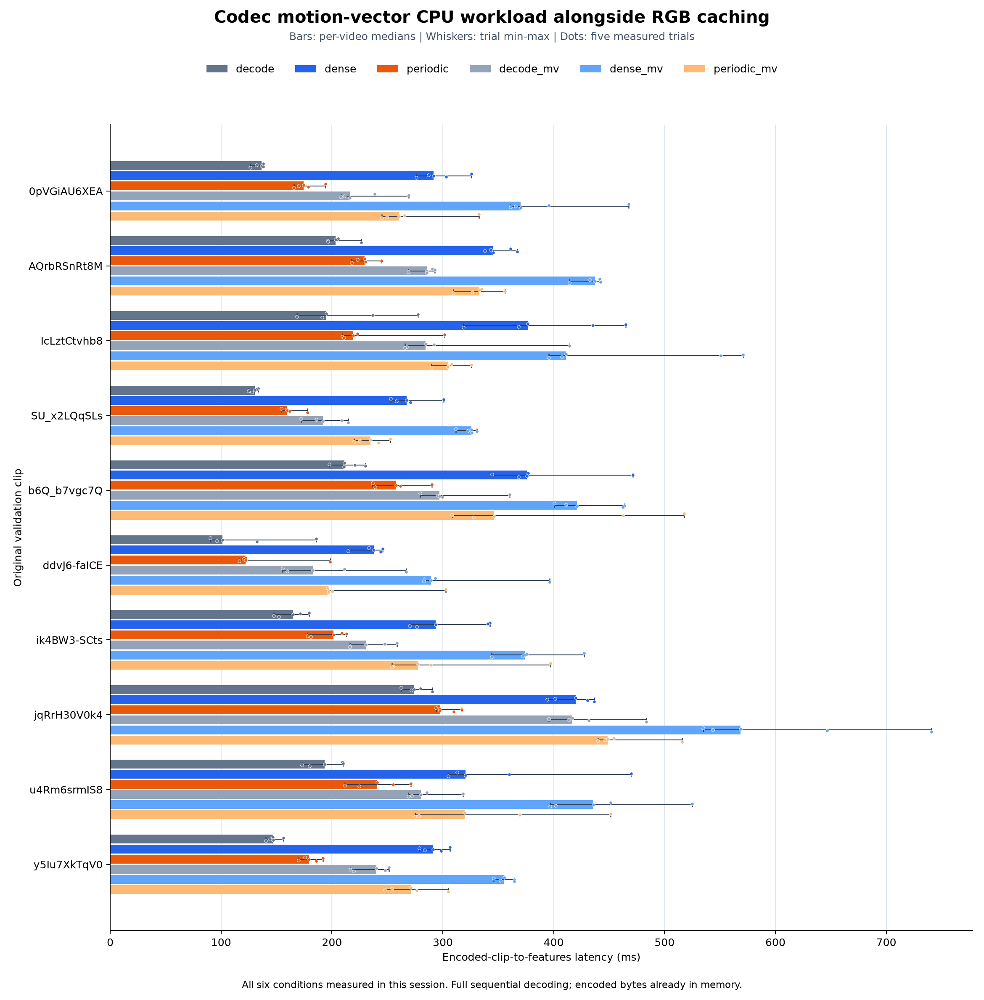

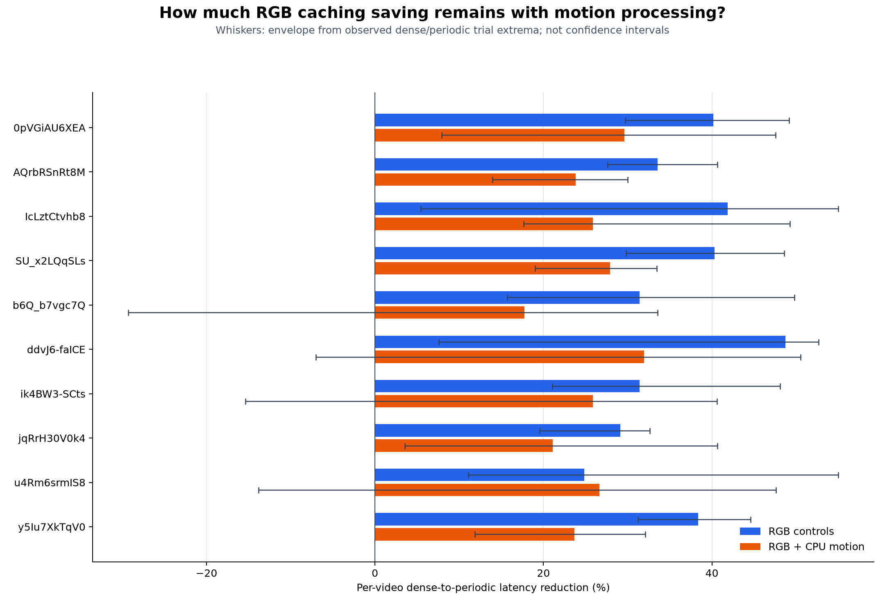

## Diagnostic: predicting cached appearance-feature drift

This offline diagnostic asks whether codec motion adds predictive information beyond cache age. `collect_cache_drift.py` imports the unchanged encoder, preprocessing, numerical settings, input validation, decoder, and motion-descriptor helpers. CUDA collection fully decodes the same ten videos, records motion at every frame, and computes fresh features at all 16 saved candidates. Saving these reference targets is diagnostic work, not a latency benchmark.

For candidate `t=1..15`, the previous cached ordinal is `r=4*floor((t-1)/4)`. The target is **appearance-feature drift**, the cosine distance between fresh features at `t` and `r`. Labels at `t=4,8,12` are measured against `r=0,4,8` **before** refreshing. Candidate 0 has no prediction label. Four cache-age inputs and six motion inputs are listed in metadata. Interval motion covers decoded frames strictly after `r` through `t`, with explicit missing-vector availability. RGB features, target-derived inputs, identifiers, future decoded-frame positions, and whole-video summaries never enter the predictor matrix.

`analyze_cache_drift.py` evaluates constant, age-only, motion-only, and age-plus-motion predictors using leave-one-source-video-out folds. The three regressions use training-fold-only standardization and fixed ridge `alpha=1.0`, with no tuning or new dependencies. Raw predictions are saved; primary MAE, RMSE, and Spearman use predictions clipped to `[0,2]`. Constant-vector correlations are missing, not zero. Metrics and paired improvements are calculated per video before equal-weight aggregation.

Run from the repository root using the existing `.venv`:

```powershell
& .\.venv\Scripts\python.exe .\collect_cache_drift.py --input data/videos/y5Iu7XkTqV0.mp4 --candidates 16 --refresh-every 4 --device cuda --output results/cache_drift_smoke
if ($LASTEXITCODE -ne 0) { throw 'CUDA smoke collection failed.' }
& .\.venv\Scripts\python.exe .\collect_cache_drift.py --input data/videos --candidates 16 --refresh-every 4 --device cuda --output results/cache_drift_v1
if ($LASTEXITCODE -ne 0) { throw 'Ten-video reference collection failed.' }
& .\.venv\Scripts\python.exe .\analyze_cache_drift.py --input results/cache_drift_v1 --output results/cache_drift_v1 --seed 20261012
if ($LASTEXITCODE -ne 0) { throw 'Drift verification or evaluation failed.' }
```

Collection preserves existing output directories by selecting and printing a fresh suffix. Use that reported directory for subsequent analysis. Completed analyses are also preserved: choose a fresh `--output` to recompute saved features without CUDA or videos. If CUDA or inputs are unavailable, resolve the environment check or run dataset preparation/inspection above; no CPU collection is substituted.

**Actual result, collected October 12, 2026:** 10 videos, 160 reference features, 150 observations, ten held-out folds, and 600 predictions. All focused checks and the original release validator passed. Adding motion reduced MAE in **6/10** videos and worsened it in **4/10**. Mean paired absolute MAE improvement was **0.018955**, median **0.009576**; mean per-video percentage improvement was **9.79%**, median **8.24%**, range **-34.82% to +61.73%**. These paired percentages differ from dividing aggregate MAE values.

Equal-weight mean per-video MAE was **0.100206** for age only, **0.081251** for age plus motion, **0.074165** for motion only, and **0.083268** for the constant baseline. Two clips account for about **80.92%** of the net absolute improvement. Age-plus-motion mean Spearman was **0.2850**, below age-only **0.3738**. Motion has useful but inconsistent predictive information under these settings; improved average magnitude prediction does not establish reliable ranking for refresh decisions. Validate fixed predictors on a larger untouched dataset before implementing a controller.

See [findings](results/cache_drift_v1/findings.md), [observations](results/cache_drift_v1/observations.csv), [held-out predictions](results/cache_drift_v1/predictions_oof.csv), [per-video metrics](results/cache_drift_v1/per_video_metrics.csv), [folds](results/cache_drift_v1/folds.json), [metadata](results/cache_drift_v1/metadata.json), and [verification](results/cache_drift_v1/verification.json). Saved features and per-frame motion enable independent label and interval audits. The previous scripts and published snapshots are unchanged.

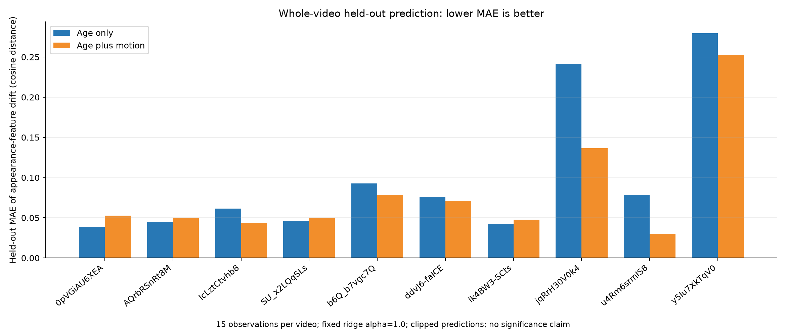

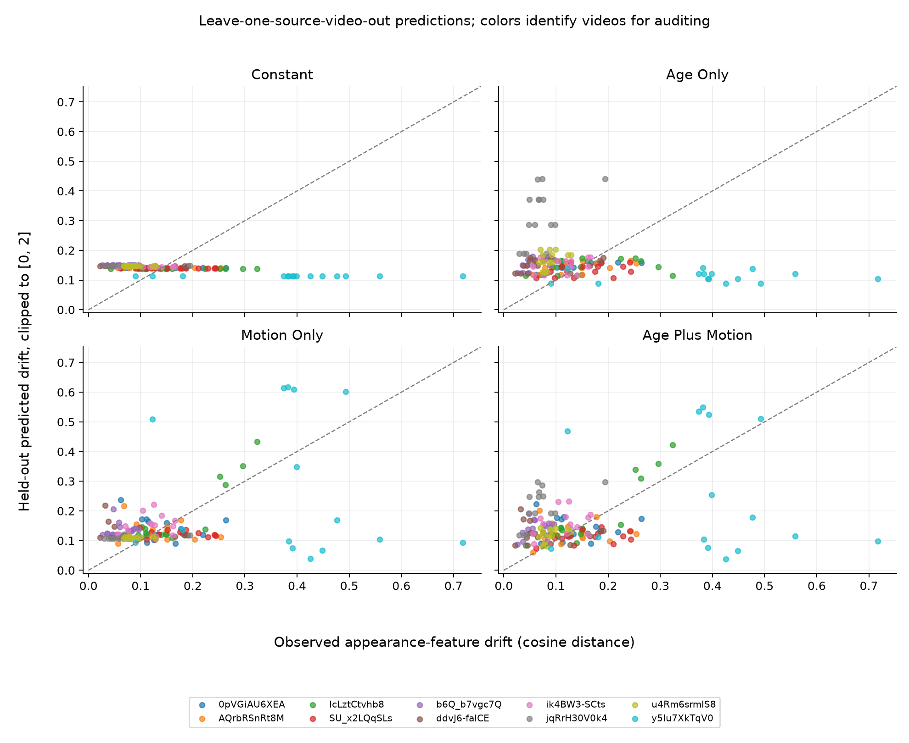

Only ten independent videos are evaluated; their 150 observations are correlated. There is no statistical significance, action-recognition accuracy, adaptive refresh benefit, or new latency claim. Simple CPU codec descriptors are not a learned motion-recognition branch. B-frames can supply future-reference vectors, making this an offline diagnostic even though aggregation uses only current/preceding decoded positions. Original encodings are preserved; strictly causal I/P-only evaluation remains separate.

## cache_drift_v2: generalization to unseen videos

The v2 workflow evaluates the same four fixed drift predictors on a custom subset of **200 new Kinetics-400 clips from 20 classes**, excluding the ten original pilot source videos. Within each class, six videos train the models, two validate the pipeline, and two form the untouched test set: **120/40/40 videos**. Source IDs and identical-file hashes cannot overlap. This is a diagnostic subset, not an official full-dataset action-recognition evaluation.

`prepare_cache_drift_v2.py` uses [CVDF's hosted validation archive shards and annotations](https://github.com/cvdfoundation/kinetics-dataset). Seed **20261013** fixes class selection, shard order, within-class ranking, and custom splits before examining drift. Downloads use resumable HTTP ranges and an explicit compressed-archive limit; annotations, source hashes, acquisition events, malformed inputs, and deterministic replacement decisions are recorded. Original encodings are preserved. The limit includes reused/reserved archives, but excludes small annotation/HTTP metadata transfers and possible retransmissions. It does not download the complete dataset.

V2 uses its own manifest; the original collector's published-ten-video checks remain intact. Eligibility requires H.264, 5–15 seconds, at least 16 decoded frames, finite increasing candidate timestamps, and successful finite CUDA feature extraction. Missing motion vectors never disqualify an otherwise valid clip. Sixteen fresh ResNet18 features and fifteen **pre-refresh** cosine-drift labels are collected per video, with unchanged encoder/weights, preprocessing, float32 settings, decoder, age/motion inputs, and interval definitions. B-frames and future-reference vectors keep this an offline diagnostic.

Run from the repository root in the existing environment:

```powershell
& .\.venv\Scripts\python.exe .\verify_cache_drift_v2.py --output results/cache_drift_v2_checks/software
if ($LASTEXITCODE -ne 0) { throw 'Software checks failed.' }
& .\.venv\Scripts\python.exe .\prepare_cache_drift_v2.py --output results/cache_drift_v2 --max-download-gib 12 --download-workers 8
if ($LASTEXITCODE -ne 0) { throw 'Dataset incomplete; inspect acquisition and shortfall records, then resume.' }
& .\.venv\Scripts\python.exe .\collect_cache_drift_v2.py --manifest results/cache_drift_v2/dataset_manifest.json --device cuda --smoke --output results/cache_drift_v2_smoke
if ($LASTEXITCODE -ne 0) { throw 'Training-video smoke collection failed.' }
& .\.venv\Scripts\python.exe .\collect_cache_drift_v2.py --manifest results/cache_drift_v2/dataset_manifest.json --device cuda --output results/cache_drift_v2
if ($LASTEXITCODE -ne 0) { throw 'Reference collection incomplete; inspect collection metadata.' }
& .\.venv\Scripts\python.exe .\analyze_cache_drift_v2.py --input results/cache_drift_v2 --output results/cache_drift_v2_checks/real_verification --verify-only --check-video-files
if ($LASTEXITCODE -ne 0) { throw 'Real-data audit failed before evaluation.' }
& .\.venv\Scripts\python.exe .\analyze_cache_drift_v2.py --input results/cache_drift_v2 --output results/cache_drift_v2 --check-video-files
if ($LASTEXITCODE -ne 0) { throw 'Fixed-model evaluation failed.' }
```

Preparation or collection can resume with the same arguments plus `--resume`. Repeating a completed run selects and prints a fresh directory; use that directory consistently in subsequent commands. Cached downloads are reused with remote identity and local hash checks. The smoke run uses only training clips. GPU failure is explicitly incomplete and never substitutes CPU feature collection. Expected complete counts are **3,200 features and 3,000 observations**: 1,800 training, 600 validation, 600 testing.

The protocol is saved before acquisition/evaluation; the final split manifest is frozen after feature eligibility, before model evaluation. Scalers, ridge coefficients (`alpha=1.0`), and the constant mean use training rows only. Validation nominates the lowest-mean-MAE candidate for later research, without changing any model or evaluating an adaptive policy. All four fixed methods are evaluated on the same forty unseen test videos. Raw predictions and predictions clipped to `[0,2]` are saved separately; primary metrics consistently use clipped predictions.

MAE, RMSE, and defined Spearman correlations are calculated per video and aggregated with equal weight. Five predefined paired comparisons include age-plus-motion versus age-only and both motion models versus the constant baseline. Percentile bootstrap intervals use **10,000 paired whole-source-video resamples**, seed **20261013**, and fixed fitted models. They describe held-out-video uncertainty conditional on the fitted models. Undefined correlations/zero-denominator percentages remain missing. Negative outcomes and gain concentration are retained; candidate positions are not treated as independent videos.

The workflow saves acquisition/exclusions, manifests, environment/source/weight identities, reference features, per-frame motion, observations, fitted models, separate validation/test predictions, metrics, comparisons, bootstrap intervals, verification, plots, and findings. No recognition accuracy, adaptive-refresh benefit, or new speedup is measured. When auditing saved prediction CSVs, use `pd.read_csv(..., float_precision="round_trip")` to preserve float64 near-ties for Spearman ranks.

### Executed v2 results

Collection completed on **2026-10-12** using the existing RTX 3080 Laptop CUDA environment without package upgrades. Six of twenty validation shards supplied the complete subset, acquiring **8.81 GiB** of compressed archives within the 12 GiB limit. Seven clips failed the predefined duration eligibility check; no feature-collection replacements were needed. The frozen split contains **200 distinct videos**, **3,200 reference features**, and **3,000 observations** (1,800/600/600). The seed is 20261013; it is not the collection date.

All figures below give each of the **40 unseen test videos** equal weight. Lower MAE/RMSE means more accurate drift prediction; higher Spearman indicates better within-video ranking. The constant model has undefined correlation because its prediction is constant. No predictions required clipping.

| Predictor | Mean per-video MAE | Median per-video MAE | Mean per-video RMSE | Mean defined Spearman |
| --- | ---: | ---: | ---: | ---: |
| Constant | 0.082098 | 0.066609 | 0.093629 | undefined (40 videos) |
| Age only | 0.080349 | 0.071062 | 0.092088 | 0.4254 |
| Motion only | 0.068331 | 0.057542 | 0.080524 | 0.4179 |
| Age plus motion | 0.066963 | 0.058671 | 0.078713 | 0.4822 |

Age plus motion improves MAE over age only in **33/40 videos**, worsens it in seven, and ties in none. Mean paired absolute improvement is **0.013386**, with conditional 95% bootstrap interval **[0.007743, 0.018699]**. Mean and median per-video percentage improvements are **11.76% and 16.30%**. The two largest positive gains account for **17.18% of net improvement**, so the result is less concentrated than the ten-video pilot. Ranking correlation rises in 26 videos and falls in 14.

| Candidate versus reference | Mean paired MAE improvement | Conditional 95% interval | Improved / tied / worsened |
| --- | ---: | --- | --- |
| Motion only versus constant | +0.013767 | [+0.008163, +0.019157] | 34 / 0 / 6 |
| Motion only versus age only | +0.012018 | [+0.006721, +0.017169] | 33 / 0 / 7 |
| Age plus motion versus constant | +0.015135 | [+0.008274, +0.021785] | 32 / 0 / 8 |
| Age plus motion versus motion only | +0.001368 | [-0.000709, +0.003418] | 23 / 0 / 17 |

Motion adds predictive information beyond age and the constant baseline on this custom subset. The MAE difference between motion-only and age-plus-motion is **inconclusive**. Motion-only improves magnitude prediction but does not improve mean ranking over age-only. Validation nominated age plus motion using the predefined rule; test outcomes did not change any models or settings. The results support a separate adaptive-policy study on fresh held-out videos, with recognition accuracy and actual refresh/latency measurements. Prediction improvement alone establishes neither preserved accuracy nor adaptive speedup.

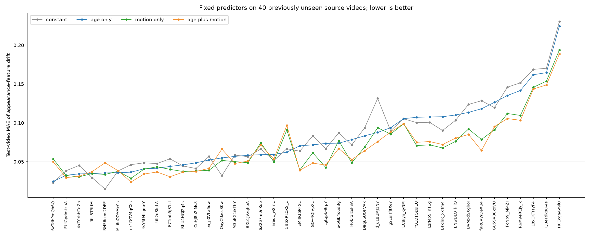

See the [complete findings](results/cache_drift_v2/findings.md), [paired improvements plot](results/cache_drift_v2/test_paired_improvements.png), [prediction plot](results/cache_drift_v2/test_predicted_vs_observed.png), [per-video metrics](results/cache_drift_v2/per_video_metrics.csv), [all bootstrap comparisons](results/cache_drift_v2/bootstrap_intervals.json), [frozen split](results/cache_drift_v2/split_manifest.json), and [verification](results/cache_drift_v2/verification.json). Eighteen software checks, the training-only smoke collection, independent real-data label/interval audits, saved-prediction metric reproduction, and the existing release validator passed. All 90 protected original sources and snapshot files remain unchanged. Archives, videos, and weights remain local and ignored by Git.

## adaptive_refresh_v1: offline policy replay at a fixed budget

This stage asks whether motion-informed decisions return better cached appearance features than periodic refresh at the same **simulated refresh count**. It uses the saved v2 features and motion descriptors from **120 training and 40 validation videos**; no test features, targets, predictions, or metrics are used. Published snapshots and scripts remain unchanged. No videos are downloaded/decoded, no RGB features are recollected, and no encoder or GPU latency benchmark runs.

All `0 <= r < t < 16` training pairs produce **120 pairs per training video / 14,400 training observations**. Age-only, motion-only, and age-plus-motion ridge models use the original four age and six motion inputs, training-only standardization, and fixed `alpha=1.0`. The target compares fresh references before any refresh decision. Sequential callbacks receive only cheap current/past inputs; cached age and motion intervals reset after every actual refresh. Reference features belong to the evaluator, which calculates post-decision output error separately.

The mandatory candidate-0 refresh counts toward B=2,4,8; dense is a separate B=16 reference. Sparse policies use exactly B refreshes and return sixteen outputs. A remaining budget of zero requires reuse; when remaining budget equals remaining candidate slots including the current slot, refreshing is forced. Periodic positions are `range(0,16,16//B)`. Random uses all ten seeds **20261013–20261022** with stable per-source hashing, averaging seeds within each video. The exact offline oracle enumerates all feasible schedules and is unavailable to callbacks.

Before validation evaluation, `protocol.json` freezes one global threshold per scored policy/budget: unique training-score quantiles at 0%,5%,...,100%, plus always-refresh and wait-until-forced settings. Predicted drift is clipped to `[0,2]`; simple motion uses current p90 displacement in pixels. Threshold selection minimizes equal-weight mean output error over the forty validation videos, with a fixed grid-order tie break. Coefficients and scalers stay unchanged; every threshold's results are saved. These are **validation-tuned developmental results**, not unseen-test evidence or statistical significance.

Run from the repository root in the existing environment:

```powershell
& .\.venv\Scripts\python.exe .\replay_refresh_policies.py --input results/cache_drift_v2 --output results/adaptive_refresh_v1 --budgets 2 4 8 --seed 20261013
if ($LASTEXITCODE -ne 0) { throw 'Replay incomplete; inspect metadata and verification before interpreting results.' }
```

Existing outputs are preserved automatically. The final reviewed run is [results/adaptive_refresh_v1_20261013T092846/](results/adaptive_refresh_v1_20261013T092846/README.md). Earlier complete runs under `results/adaptive_refresh_v1/`, `results/adaptive_refresh_v1_20261013T090709/`, and `results/adaptive_refresh_v1_20261013T091210/` remain local. Verification and reporting refinements did not change the fitted parameters, thresholds, scientific CSVs, or aggregate results; [run consistency](results/adaptive_refresh_v1_20261013T092846/run_consistency.json) checks that explicitly.

Mean output-feature cosine error over sixteen candidates, averaged equally across forty validation videos (lower is better):

| Policy | B=2 | B=4 | B=8 |
| --- | ---: | ---: | ---: |
| Periodic | 0.134518 | 0.094093 | 0.049636 |
| Random, all ten seeds | 0.139089 | 0.104342 | 0.057898 |
| Simple motion threshold | 0.141879 | 0.109971 | 0.068390 |
| Age only | 0.128320 | 0.093565 | 0.051201 |
| Motion only | 0.137218 | 0.103380 | 0.057836 |
| Age plus motion | 0.126060 | 0.093840 | 0.051125 |
| Offline oracle | 0.107819 | 0.068893 | 0.031980 |

Dense **B=16** mean error is approximately zero (`3.157e-17`). At the primary **B=4**, age plus motion improves nineteen videos and worsens twenty-one. Its mean absolute reduction is only **0.000254**; mean per-video percentage reduction is **-0.65%**, and mean per-video oracle-gap closure is **-21.31%**. The oracle's mean per-video possible reduction is **25.36%**. Averaging absolute reductions, normalized percentages, and normalized oracle gaps uses different denominators and can give different signs; a ratio of aggregate means is a separate calculation.

The combined policy beats random, simple motion, and motion-only in average output error, but slightly trails age-only at B=4. It helps at B=2 and is worse than periodic at B=8. Motion-only is worse than periodic at every budget. Better drift prediction has **not translated into consistent adaptive-policy fidelity**. At B=8 the combined policy averages 2.73 forced refreshes; 75% of videos require forced spending, suggesting budget allocation deserves inspection.

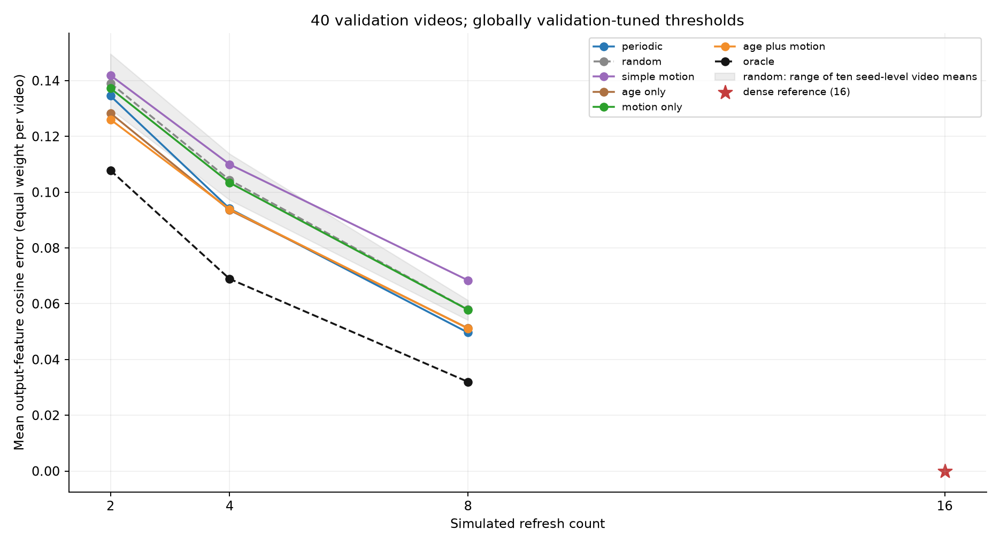

See [findings](results/adaptive_refresh_v1_20261013T092846/findings.md), [B=4 per-video plot](results/adaptive_refresh_v1_20261013T092846/per_video_B4.png), [success/failure timelines](results/adaptive_refresh_v1_20261013T092846/example_timelines.png), [per-video metrics](results/adaptive_refresh_v1_20261013T092846/validation_per_video_metrics.csv), and [verification](results/adaptive_refresh_v1_20261013T092846/verification.json). Twenty-two focused checks and the real-data budget/cache/interval/oracle audits passed; saved traces reproduce the results. All 925 protected existing files remain unchanged, and release validation passes.

Recommendation: preserve this mixed/negative result. A frozen fresh-test replay could audit it, but do not advance directly to GPU timing or a recognition probe for this rule. Inspect predictor/decision-rule quality and budget allocation on training or new development data first; do not repeatedly tune these validation videos for a positive result. This measures appearance-feature fidelity, not recognition accuracy. Replay measures no decoding, motion-processing, controller, or GPU latency. Future-reference codec vectors and full-clip candidate selection make it offline. No confidence intervals or significance claims are made.

## Limitations and roadmap

This is a preliminary feasibility benchmark, not evidence of maintained recognition accuracy or a production streaming system.

- Recognition accuracy and the effect of stale appearance features on recognition remain unevaluated.
- The October 10 pilot excludes motion processing. The follow-up measures codec-vector export and simple CPU descriptor overhead; a learned motion branch, actual adaptive-controller timing/accuracy, and action-classification head remain unevaluated.
- The clips are low-resolution; higher-resolution and 1080p performance remain unevaluated.
- File loading is measured separately and excluded from the reported metric.
- Offline full-clip processing time is not live-stream response latency.
- Ten clips and five repetitions per mode are a small pilot on one laptop; observed trial ranges and cross-run differences limit generalization.

The follow-up confirms savings remain with a substantial CPU codec-vector workload. Next, profile export/access/percentile computation, use longer controlled runs, evaluate recognition accuracy and motion usefulness for refresh decisions, and test controlled I/P-only encoding for a separate causal-inference study. Compare adaptive refresh policies with the periodic rule and test higher resolutions. If savings disappear, profile decoding/conversion/preprocessing/transfers; if periodic becomes slower, inspect overhead and variability. Fix incorrect counters before interpreting performance.

## Repository layout

- `prepare_data.py`: archive validation, extraction, and selected-video copies.
- `inspect_video.py`: full sequential inspection and saved candidates.
- `benchmark.py`: shared verification/processing logic and CUDA timing.
- `summarize.py`: validation, per-video summaries, chart, and findings.
- `check_env.py`: environment and GPU correctness checks.
- `research_utils.py`: project-relative paths, manifest helpers, and decoder settings.
- `validate_release.py`: public snapshot and documentation validation.
- `motion_utils.py` / `inspect_motion.py`: codec-vector export, CPU descriptors, and per-frame diagnostics.
- `benchmark_motion.py` / `summarize_motion.py`: six-condition correctness/timing and motion-overhead analysis.
- `prepare_cache_drift_v2.py` / `collect_cache_drift_v2.py` / `analyze_cache_drift_v2.py`: bounded dataset acquisition, CUDA reference collection, and fixed train/validation/test drift evaluation.
- `cache_drift_v2_utils.py` / `verify_cache_drift_v2.py`: frozen protocol, identity/preservation checks, and isolated software fixtures.
- `replay_refresh_policies.py` / `refresh_policy_utils.py` / `test_refresh_policies.py` / `refresh_replay_report.py`: fixed-budget offline policy replay, leakage/budget checks, and developmental findings.
- `requirements.txt` / `requirements-cuda.txt`: tested dependency installation, with CUDA separated.
- `results/pilot_2026_10_10/`: curated public results and exact tested environment.
- `results/motion_overhead_2026_10_11/`: curated codec-vector overhead experiment, with actual run timestamps.
- `results/cache_drift_v1/` / `results/cache_drift_v2/`: curated drift-prediction diagnostics and their audit artifacts.
- `results/adaptive_refresh_v1_20261013T092846/`: curated offline validation policy replay, with earlier runs preserved locally.
- `data/source/`, `data/videos/`, `.venv/`, and other `results/` subfolders: local, ignored assets and outputs.

## Credits and license

Original project code is released under the [MIT License](LICENSE), **Copyright (c) 2026 Siyu Han**. Dataset and pretrained-weight terms remain separate.

This project uses **PyTorch/torchvision** for tensors and ResNet18, **PyAV/FFmpeg** for video decoding, and the **OpenMMLab/MMAction2** Kinetics tiny archive derived from the **Kinetics dataset**. V2 uses **CVDF's hosted Kinetics-400 archives and annotations**, credited in its dataset manifest. NumPy, pandas, matplotlib, and Pillow support analysis and preprocessing. See [third-party notices and upstream terms](THIRD_PARTY_NOTICES.md). No downloaded videos, pretrained weights, or dependency source code are distributed in this repository.


## budget_aware_refresh_v2: oracle action-value supervision

This development experiment tests whether age, codec motion, and remaining refresh budget improve cached appearance fidelity. It preserves the published v1 replay. Only the original v2 **training** membership supplies data: within each of twenty classes, seed **20261014** selects four training and two development sources, giving **80 training /40 development videos**. Original validation/test feature arrays, motion tables, predictions and evaluation results are excluded. See the [frozen development split](results/budget_aware_refresh_v2/development_split.json).

The eighty sources provide **9,600 all-history drift pairs** and **32,480 optional oracle-action states**: 1,120 at B=2, 13,440 at B=4, and 17,920 at B=8. Exact dynamic programming supplies the signed label `(Q_reuse-Q_refresh)/16`, using privileged future references for training only. Separate age/budget and age/motion/budget ridge models are fitted per budget with training-only population scaling, alpha=1.0 and an unpenalized intercept. Their optional decision threshold is fixed at zero; signed predictions are never clipped. Old drift baselines are refitted on these same eighty videos, clip predicted drift to [0,2], and recompute inputs after each actual refresh. Pacing uses only the predefined lambdas 0,0.05,0.10,0.20. Threshold settings are selected globally on these development videos; these are not confirmation-test results.

Every sparse trajectory has exactly B simulated refreshes, including candidate0, and sixteen outputs. Exhausted budget requires reuse; remaining budget equal to remaining candidate slots forces refresh. Random averages all ten seeds 20261014-20261023 within each video. Privileged actual-drift thresholding is isolated from deployable callbacks and is not a mathematical upper bound. The full-future oracle is a separate diagnostic bound. Summed evaluator-only action regret equals mean-error excess over that oracle.

Run from the repository root:

```powershell
& .\.venv\Scripts\python.exe .\replay_budget_aware_policies.py --input results/cache_drift_v2 --output results/budget_aware_refresh_v2 --budgets 2 4 8 --seed 20261014
```

Focused fixtures and an independent audit can also be run:

```powershell
& .\.venv\Scripts\python.exe .\test_budget_aware_refresh.py
& .\.venv\Scripts\python.exe .\audit_budget_aware_refresh.py --input results/budget_aware_refresh_v2 --source results/cache_drift_v2
```

Existing completed or partial outputs are preserved by choosing a fresh directory. This executed snapshot is [results/budget_aware_refresh_v2/](results/budget_aware_refresh_v2/README.md). Equal-video mean post-decision output-feature cosine error (lower is better):

| Policy | B=2 | B=4 | B=8 |
| --- | ---: | ---: | ---: |
| Periodic | 0.137533 | 0.098383 | 0.049331 |
| Random, ten seeds | 0.148065 | 0.107923 | 0.059255 |
| Age drift threshold | 0.141244 | 0.097781 | 0.049480 |
| Age + motion drift threshold | 0.143249 | 0.105307 | 0.047850 |
| Drift + budget pacing | 0.142781 | 0.100075 | 0.044148 |
| Action value: age + budget | 0.145639 | **0.095387** | 0.050709 |
| Action value: age + motion + budget | 0.144809 | 0.096393 | 0.046827 |
| Actual drift threshold, privileged | 0.137411 | 0.100359 | 0.041695 |
| Full-future oracle, privileged | 0.111000 | 0.067008 | 0.030979 |

**Mixed outcome.** At B=4, the motion-aware value controller's mean absolute improvement over periodic is **0.001991**, with **+1.97% mean per-video improvement**, but **20 videos improve and 20 worsen**. It beats pacing in average error by 0.003683 (22 improved/18 worsened), while its mean per-video percentage versus pacing is **-11.32%**. Different per-video normalization denominators explain those different signs; a ratio of aggregate means is another calculation. Adding motion is worse than age/budget alone by **0.001006** at B=4 (11 improved/17 tied/12 worsened). Both value controllers are worse than periodic at B=2. Motion helps versus age/budget alone at B=8, but pacing beats the motion-aware value controller. Thus motion does not contribute consistently, and the proposed controller is not consistently best across budgets.

Privileged actual-drift thresholding improves mean error over predicted-drift thresholding at B=4, but worsens 27 videos versus improving ten, and remains worse than periodic. Better instantaneous drift information does not by itself fix greedy budget allocation. B=4 action-value policies have more costly delayed decisions than costly refresh decisions; traces and exact action regrets make these errors auditable. Low forced-refresh counts alone are not evidence of success.

Nineteen focused checks, all 360 initial DP/exhaustive comparisons, all exact-budget/cache/interval/regret checks and saved-metric reproduction passed. The independent audit checks all **9,600** drift labels/intervals and all **32,480** action targets using a separate bottom-up DP, and verifies all eight regressions using augmented least squares. All **953** protected existing files remain unchanged; release validation passes. No videos/weights were downloaded, no RGB features recollected, no packages changed, and actual encoder executions are **zero**.


See [findings](results/budget_aware_refresh_v2/findings.md), [B=4 per-video improvements](results/budget_aware_refresh_v2/per_video_B4_improvement.png), [success/failure timelines](results/budget_aware_refresh_v2/example_timelines.png), [per-video metrics](results/budget_aware_refresh_v2/development_per_video_metrics.csv), [verification](results/budget_aware_refresh_v2/verification.json), and [independent audit](results/budget_aware_refresh_v2/independent_verification.json).

The modest B=4 average gain supports a **frozen confirmation of both value controllers**, not adoption or claims of a motion benefit. The [prospective protocol](results/budget_aware_refresh_v2/fresh_test_protocol.json) fixes models/settings for 100 new videos, five per existing class, excluding every prior source and duplicate hash, with paired whole-video uncertainty and no test-driven retuning. That set was not acquired or evaluated. This remains appearance fidelity, not recognition accuracy; it measures no decoding/controller/motion/GPU latency. Full-clip candidates and future-reference vectors make it offline, and oracle labels use future RGB during training. Repeated states from one video are not independent videos.


## fresh_refresh_confirmation_v1: frozen 100-video confirmation

This completed confirmation uses 100 genuinely new source videos, five from each of the twenty classes in the existing prospective protocol. The protocol was copied byte-for-byte; models/scalers, thresholds, pacing lambdas, features and primary B=4 comparison were frozen. There was no refitting or tuning. Prior exclusions were frozen once: the original 210 IDs/hashes plus 113 additional previously inspected/collected IDs and 106 hashes. No cohort overlap or duplicate encoded files remains.

Six verified cached archives contributed 8.814 GiB of cache accounting. Five new compressed archives reserved/transferred **7.003 GiB**, below the 12 GiB new-download cap; cached bytes do not consume that cap. Two clips failed input eligibility and were replaced by the next predetermined same-class candidates. Network or machine failures never caused a replacement. A transient Windows progress-write/UTF-8 error was corrected before fresh policy evaluation, with original source copies and a correction log preserved; the interrupted clip was retried.

Reference collection retained **1,600** CUDA float32 ResNet18 features. Actual forward calls were **1,628**: 1,600 retained, sixteen original-training smoke calls and twelve returned forwards from the interrupted attempt. Collection/inspection elapsed time is not adaptive inference latency. Saved-feature replay performs zero encoder calls and produced **5,500 trajectories, 88,000 candidate traces and 2,800 per-video policy/budget rows**. All methods and all ten original random seeds were evaluated; seeds were averaged within each video.

Run from the repository root:

```powershell
& .\.venv\Scripts\python.exe .\run_fresh_refresh_confirmation.py --frozen-run results/budget_aware_refresh_v2 --output results/fresh_refresh_confirmation_v1 --device cuda --max-download-gib 12 --download-workers 8
```

For an incomplete run, append `--resume` with the same configuration. This freezes progress/exclusions and validates identities without resampling. A completed run is audited/reproduced without acquiring another cohort or running the reference encoder again. Additional synthetic acquisition/statistics checks use:

```powershell
& .\.venv\Scripts\python.exe .\verify_fresh_confirmation.py --frozen-run results/budget_aware_refresh_v2
```

**Primary confirmation: inconclusive.** Fresh B=4 mean feature errors are periodic **0.093144**, motion-aware value **0.092595**, age/budget value **0.093634**, and pacing **0.095479**. Positive paired gains favor the candidate:

| B=4 comparison | Mean paired gain | 95% percentile bootstrap interval |
| --- | ---: | --- |
| Motion value vs periodic (primary) | +0.000550 | [-0.003083, +0.004406] |
| Motion value vs pacing (secondary) | +0.002884 | [-0.002206, +0.008260] |
| Motion value vs age/budget value (secondary) | +0.001039 | [-0.000327, +0.002415] |
| Age/budget value vs periodic (secondary) | -0.000490 | [-0.003904, +0.003256] |

Every B=4 interval includes zero. The primary improves 48 videos and worsens 52; only seven of twenty classes improve descriptively. Mean per-video percentage change is **-1.90%**, whereas the separate percentage of aggregate means is **+0.59%**. Those denominators differ. The largest two positive gains equal 287.48% of the small positive net sum because other losses offset them. Gains are not broadly consistent.

B=2 motion-value versus periodic is -0.000476 [-0.006610,+0.006631]; B=8 is +0.000102 [-0.001339,+0.001626]. Both are inconclusive. The isolated B=2 motion-versus-age/budget secondary interval is positive (+0.005445 [+0.002420,+0.008984]), but neither controller demonstrates lower error than periodic there. Secondary intervals are marginal/unadjusted; no budget or winning method was selected after results.

The bootstrap uses 10,000 whole-source-video resamples, PCG64 seed20261014, one shared index matrix across comparisons, and linear percentiles. It excludes training uncertainty and conditions on the fixed models and existing sampled classes. Candidates, frames and random seeds are not independent bootstrap units. Development and fresh results are reported separately.

Verification includes fifteen focused software checks, exact reproduction of all forty original development videos (1,120 metrics/2,200 schedules), all fresh budget/cache/interval/regret and DP/exhaustive checks, source/hash exclusions, unchanged weights/models/settings, independent saved-metric/bootstrap calculations, and a separate full replay reproducing every schedule and interval with zero encoder/fitting calls. All 988 tracked previous experiment sources/artifacts remain unchanged; release validation passes.

See [findings](results/fresh_refresh_confirmation_v1/findings.md), [frozen manifest](results/fresh_refresh_confirmation_v1/frozen_test_manifest.json), [metadata](results/fresh_refresh_confirmation_v1/metadata.json), [paired intervals](results/fresh_refresh_confirmation_v1/bootstrap_intervals.json), [per-video metrics](results/fresh_refresh_confirmation_v1/test_per_video_metrics.csv), [verification](results/fresh_refresh_confirmation_v1/verification.json), and [full replay reproduction](results/fresh_refresh_confirmation_v1/independent_replay_reproduction.json). The curated snapshot includes reference features, motion descriptors, replay data and audit records. Videos, archives, weights and environments remain local and ignored by Git.

The [publication review](results/fresh_refresh_confirmation_v1/publication_review.json) records a post-evaluation correction to the Git inventory guard so tracking new files does not prevent completed-run audits. Exact collection-time sources are preserved alongside their original hashes; policy logic and scientific results are unchanged. One local path in an error message was made relative for publication.

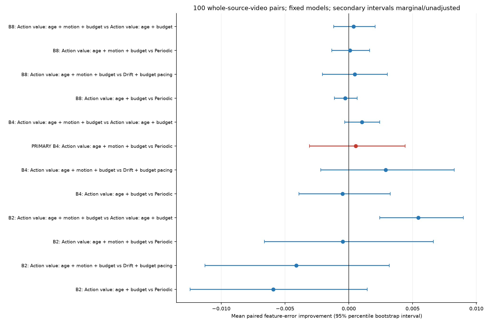

This does not confirm a useful B=4 motion benefit or superiority over pacing. Keep periodic as the baseline and inspect decision errors on training or separate development data; do not retune this completed test or add videos until its interval becomes favorable. These findings do not justify an adaptive-speedup or recognition-quality claim. Appearance fidelity is not recognition accuracy; full-clip candidates and future-reference codec vectors keep replay offline. No recognition or actual adaptive-latency experiment was run.

## task_aware_oracle_v1: action-classification hindsight feasibility

This separate experiment reuses saved ResNet18 references from the frozen 80-training/40-development split, plus 40 previously evaluated original v2 test videos as a separately labeled **exploratory** cohort. These are custom diagnostic memberships drawn from CVDF official validation archives, not an official full-Kinetics recognition evaluation. It excludes original custom validation arrays and all feature/motion data from the completed 100-video confirmation. Official CVDF annotation hashes and ground-truth labels are verified. Nothing was downloaded or recollected; actual appearance-encoder executions and video decodes are zero.

A temporal-mean, linear 20-class classification head is trained with cross entropy on the 80 training sources. Normalization uses training data only. A predefined four-value regularization grid is selected on development dense accuracy, then loss; the chosen lambda is 0.1. Dense accuracy is 100% training, 50% development and 52.5% exploratory, versus 5% chance/majority. This exceeds chance, but the small cohort and 47.5-point train/test gap limit recognition reliability.

The task oracle exactly enumerates 15, 455 and 6,435 schedules at B=2,4,8, with refresh0 mandatory. It minimizes the trained head's true-label cross entropy after replaying sixteen latest-cache outputs. **It uses evaluation labels and future reference features: a privileged, noncausal hindsight bound, not deployable recognition performance.** Dense B=16, periodic, ten-seed random, unchanged frozen age/budget controllers and the exact feature-error oracle use the same classifier. Random seeds are averaged within each video.

| Exploratory cohort, B=4 unless dense | Top1 / macro accuracy | Cross entropy (nats) | Feature cosine error |
| --- | ---: | ---: | ---: |
| Dense B=16 | 52.50% | 1.458322 | approximately 0 |
| Periodic | 52.50% | 1.446087 | 0.095736 |
| Random, ten-seed average | 51.25% | 1.549083 | 0.106250 |
| Frozen age/budget | 52.50% | 1.486941 | 0.096839 |
| Frozen age/motion/budget | 55.00% | 1.530569 | 0.094659 |
| Feature oracle, hindsight | 52.50% | 1.526141 | 0.070790 |
| Task oracle, label + hindsight | 67.50% | 0.994350 | 0.114641 |

Primary B=4 task-oracle versus periodic: development accuracy gain +25pp [12.5,40.0], exploratory +15pp [5.0,27.5]. Exploratory loss gain is +0.451737 nats [0.356726,0.549307]. Intervals use 10,000 paired whole-video resamples with fixed models, PCG64 seed20261015 and linear percentiles. All 40 exploratory losses improve by construction of the loss-minimizing oracle; correctness improves in six videos, ties in34 and worsens in0. These intervals quantify optimistic oracle headroom, not ordinary held-out generalization.

Improving cosine fidelity did not improve exploratory top1 and worsened loss. Periodic B=4 feature error versus dense-relative loss change has Spearman -0.090, and task/feature oracles choose identical schedules in0/40 exploratory videos. Neither this association nor classifier margins establish semantic temporal importance. Development and exploratory results are kept separate.

Run from the repository root:

```powershell
& .\.venv\Scripts\python.exe -m unittest test_task_aware_oracle -v
& .\.venv\Scripts\python.exe .\run_task_aware_oracle.py --input results/cache_drift_v2 --frozen-run results/budget_aware_refresh_v2 --output results/task_aware_oracle_v1 --seed 20261015
& .\.venv\Scripts\python.exe .\run_task_aware_oracle.py --input results/cache_drift_v2 --output results/task_aware_oracle_v1 --audit-only
& .\.venv\Scripts\python.exe .\validate_release.py
```

Refitting needs the original small `data/source/cache_drift_v2/val.csv` (or `--annotations` pointing to an identical copy). Saved-result audit uses published saved features and head parameters without videos, CUDA, annotations or refitting. Existing outputs are preserved by selecting a fresh run directory. The nine focused tests, real-controller isolation checks, independent loss/replay/bootstrap reproduction and release validator pass. An interrupted float64 verification check and a later plot-spacing correction are documented with exact source copies; measurements and the frozen classifier are unchanged.

Decision: **CONTINUE cautiously** with task-aware feasibility work, strengthen/validate the recognition baseline, and investigate causal decision signals on separate development sources before a fresh confirmation. This is not evidence of a deployed accuracy gain, latency or speedup. No new learned controller is implemented here.

See [findings](results/task_aware_oracle_v1/findings.md), [protocol](results/task_aware_oracle_v1/protocol.json), [per-video results](results/task_aware_oracle_v1/per_video_metrics.csv), [paired intervals](results/task_aware_oracle_v1/bootstrap_intervals.json), [head parameters](results/task_aware_oracle_v1/classifier_parameters.json), [verification](results/task_aware_oracle_v1/verification.json) and [implementation corrections](results/task_aware_oracle_v1/implementation_corrections.json).

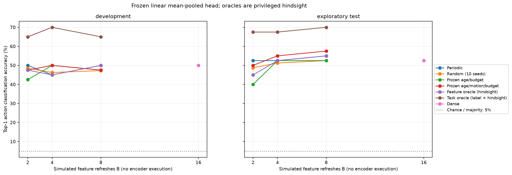

## recognition_baseline_v2: larger-data recognition learning curve

Status: **completed and verified**. The [frozen protocol](results/recognition_baseline_v2/protocol.json) fixes seed 20261016, the original twenty-class ordering, a 400-video training pool, 100 development videos and the separate existing 40-video exploratory cohort. The 400-video-trained classifier is primary; nested 80/200-video models are learning-curve diagnostics. Existing 40 development sources remain, with three new sources/class added. Completed fresh-confirmation sources and every prior validation/test membership are excluded from training.

The [preflight inventory](results/recognition_baseline_v2/preflight.json) records eleven verified cached validation archives, 160 compatible saved references, 380 new reference clips required, free disk space and acquisition estimates. Official training archives are available but uncached; this resource-bounded run freezes a custom CVDF validation-source split before training. It is not an official Kinetics recognition benchmark. All new HTTP response body bytes, including retries and conservatively charged interrupted reservations, count against the 20 GiB cap; preexisting verified caches do not.

The ResNet18 weights, preprocessing, 16 candidate rules, float32 CUDA batch-size-one references and the v1 linear mean-pooled float64 classifier recipe remain fixed. Each nested size uses its own training-only normalization and the same four regularization values; selection uses dense development accuracy, then loss, then grid order. All three selected models freeze before exploratory evaluation. B=4 compares periodic, exact feature oracle and all 455-schedule true-label task oracle with dense B=16. Oracle results are privileged hindsight, not deployable accuracy or an accuracy-maximizing bound. No arbitrary accuracy threshold is used as a publication gate.

Run from the repository root:

```powershell
& .\.venv\Scripts\python.exe -m unittest test_recognition_baseline_v2 -v
& .\.venv\Scripts\python.exe .\run_recognition_baseline_v2.py --preflight-only --max-download-gib 20
& .\.venv\Scripts\python.exe .\run_recognition_baseline_v2.py --resume --max-download-gib 20 --download-workers 8
& .\.venv\Scripts\python.exe .\run_recognition_baseline_v2.py --audit-only
```

`--resume` validates configuration and source identities, retains acquisition progress and reuses frozen selections. A completed run is audited rather than overwritten. If acquisition cannot reach the planned counts, the run records exact class shortages and does not train on a smaller convenience subset. Reference collection time does not measure adaptive inference latency; replay executes zero encoders. Previously completed results remain intact.

All 540 source identities and encoded hashes are distinct. The run retained 6,080 new CUDA reference features from 380 clips, with zero extra or failed encoder forwards, and reused 2,560 reference features. Five new compressed archives plus the counted training-list probe transferred 7,521,016,370 HTTP body bytes (7.0045 GiB), below the 20 GiB cap. Fourteen candidates failed input eligibility and were replaced in the frozen order. No old experiment was rewritten.

| Nested training videos | Training dense accuracy | Development dense accuracy | Exploratory dense accuracy |
| ---: | ---: | ---: | ---: |
| 80 | 100% | 61% | 45% |
| 200 | 98% | 70% | 60% |
| 400, primary | 100% | 72% | 65% |

The new 80-video subset shares only 11 sources with the old v1 subset. Learning-curve comparisons use the new nested subsets and fixed evaluation cohorts. Selected regularization values are 1.0, 1.0 and 0.01; selection used development dense results only. The primary training/development gap is still 28 percentage points, and its training/exploratory gap is 35 points.

| Primary 400-video classifier | Development accuracy / CE | Exploratory accuracy / CE |
| --- | ---: | ---: |
| Dense B=16 | 72% / 1.096979 | 65% / 1.112254 |
| Periodic B=4 | 70% / 1.150692 | 65% / 1.075162 |
| Feature oracle B=4, hindsight | 70% / 1.168484 | 65% / 1.271517 |
| Task oracle B=4, label + hindsight | 86% / 0.565185 | 87.5% / 0.492441 |

Cross entropy is in nats per video; macro accuracy equals top1 because classes are balanced. Primary task-oracle versus periodic accuracy gains are +16pp [9,23] on development and +22.5pp [10,35] on exploratory. Loss reductions are +0.585507 [0.440676,0.747974] and +0.582720 [0.331209,0.885879] nats. Intervals use 10,000 whole-video paired resamples with fixed classifiers; saved index matrices are shared across comparisons within each cohort. Development is tuned, and exploratory membership was previously evaluated.

The hindsight advantage persists for this stronger classifier. The feature oracle lowers exploratory cosine error from 0.095736 to 0.070790, but leaves accuracy at 65% and worsens loss. The task oracle has higher cosine error (0.119230) while improving its defined recognition objective. Cache repetition exactly changes temporal weights for the linear mean-pooled head, so true-label temporal reweighting can explain part of the oracle advantage. This does not establish a label-free causal policy, measured speedup or publication-level novelty. Next, test a label-free temporal selection/reweighting baseline on development sources, then freeze it before a genuinely new confirmation cohort.

See [findings](results/recognition_baseline_v2/findings.md), [dataset manifest](results/recognition_baseline_v2/dataset_manifest.json), [learning curve](results/recognition_baseline_v2/learning_curve.json), [per-video metrics](results/recognition_baseline_v2/per_video_metrics.csv), [intervals](results/recognition_baseline_v2/bootstrap_intervals.json), [verification](results/recognition_baseline_v2/verification.json) and [independent checks](results/recognition_baseline_v2/independent_verification.json). Additional cohort/label/accounting checks run with:

```powershell
& .\.venv\Scripts\python.exe .\verify_recognition_baseline_v2.py
```

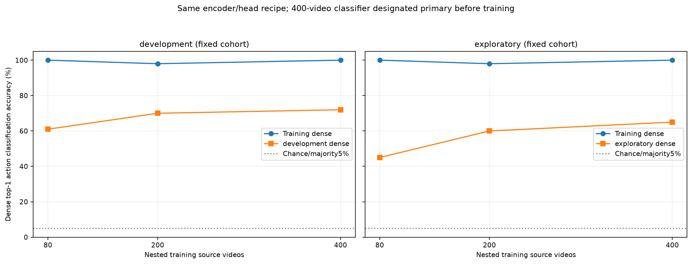

## task_signal_diagnostic_v1: can cheap observations predict task value?

Status: **completed; the tested signals and linear probes did not demonstrate useful prediction**. This saved-feature diagnostic freezes the primary 400-video-trained classifier and uses the existing 100 development and 40 exploratory sources separately. It performs zero RGB encoder calls, decodes, downloads or recognition-classifier fits. Neither cohort is a fresh confirmation; development previously selected the recognition head's regularization.

Dense/periodic recognition results reproduce exactly within numerical tolerance. The unchanged age/motion/budget controller gives 68% development and 60% exploratory accuracy under this classifier, compared with periodic's 70% and 65%. Prediction changes are not automatically harmful: exploratory periodic disagrees with dense on two sources, but harms none of the 26 dense-correct sources. Its feature-error/loss-change Spearman correlation is 0.0096; development periodic's is 0.0320. Policies and cohorts are analyzed separately.

Each video contributes nine equal-budget counterfactuals: move one planned periodic refresh earlier, retaining exactly four refreshes and sixteen latest-cache outputs. Gain is periodic cross entropy minus modified-schedule cross entropy. This is a prescribed schedule-change target, not an optimal action value. There are 900 development and 360 exploratory examples from 100 and 40 source videos. True current drift is evaluator-only; its gain correlations are -0.0686 and -0.0601.

Five class-stratified source-grouped folds evaluate four fixed ridge probes (alpha=1, sum-squared-residual objective, training-only normalization). A uses age/budget; B adds six existing motion descriptors; C adds cached/past-output confidence summaries; D adds both. Full-development fits freeze after saving all OOF predictions and before exploratory evaluation. Labels, uncomputed RGB, future descriptors and evaluator targets do not enter the feature builder.

| Predictor | Development OOF MAE (nats) | Exploratory MAE (nats) |
| --- | ---: | ---: |
| Constant zero | 0.253456 | 0.295243 |
| Training mean | 0.261289 | 0.301426 |
| A: age/budget | 0.264103 | 0.303550 |
| B: age/budget + motion | 0.284141 | 0.323415 |
| C: age/budget + cached prediction | 0.265663 | 0.309126 |
| D: age/budget + both | 0.284506 | 0.330833 |

Primary improvement MAE(A)-MAE(D) is **-0.020402 nats**, with 95% interval [-0.031925, -0.009675]; exploratory is -0.027283 [-0.043709, -0.013034]. D worsens 63/100 development and 26/40 exploratory sources. Intervals use 10,000 whole-video paired resamples, PCG64 seed 20261017, keeping all nine examples together. They condition on saved probes and omit full training/model-selection uncertainty. Cached confidence and motion each worsen MAE in the predefined component comparisons; constant zero is best by MAE.

Seven focused fixtures, 1,260 independent explicit counterfactual replays, 420 real input-isolation mutations, training-only scaler/independent ridge checks, saved-metric/bootstrap reproduction, and release validation pass. Earlier scientific sources and snapshots remain unchanged.

Run from the repository root:

~~~powershell
& .\.venv\Scripts\python.exe -m unittest test_task_signals -v
& .\.venv\Scripts\python.exe .\analyze_task_signals.py --input results/recognition_baseline_v2 --output results/task_signal_diagnostic_v1 --seed 20261017
& .\.venv\Scripts\python.exe .\analyze_task_signals.py --input results/recognition_baseline_v2 --output results/task_signal_diagnostic_v1 --seed 20261017 --audit-only
~~~

Completed outputs are audited without overwriting them. See [findings](results/task_signal_diagnostic_v1/findings.md), [protocol](results/task_signal_diagnostic_v1/protocol.json), [folds](results/task_signal_diagnostic_v1/fold_manifest.json), [clip audit](results/task_signal_diagnostic_v1/clip_error_analysis.csv), [counterfactuals](results/task_signal_diagnostic_v1/counterfactual_examples.csv), [probe metrics](results/task_signal_diagnostic_v1/aggregate_metrics.json), [paired intervals](results/task_signal_diagnostic_v1/bootstrap_intervals.json), and [verification](results/task_signal_diagnostic_v1/verification.json).

Do not build a sequential controller from these probes. First test whether a low-cost task-trained temporal-change signal predicts refresh gain beyond constant and age/budget baselines in a separately frozen study. These negative results apply to the tested signals, linear models and counterfactuals; they do not rule out all task-aware policies. Full-clip candidates and future-reference codec vectors keep this offline. Adaptive recognition performance and end-to-end latency remain unmeasured.

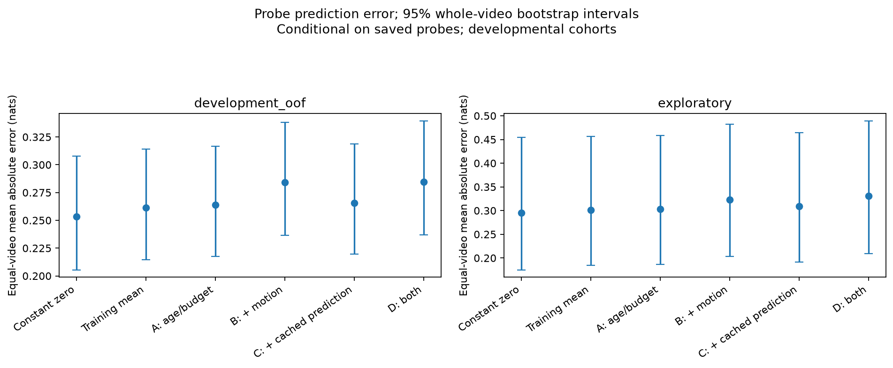

## task_signal_ablation_v2: capacity, cached information, or current appearance?

Status: **completed and verified locally; no positive decision-utility result**. This fixed 3-input x 2-predictor ablation reuses the exact 100 development/40 exploratory sources, 900/360 counterfactual examples, prior five-fold assignments and frozen recognition head. Nothing was downloaded, decoded, encoded or recognition-retrained. The completed fresh-confirmation cohort was not parsed.

S reproduces the previous 16 summary inputs. C adds all 40 cached/past-output class-centered logits, using only candidates before t. P adds 20 centered current RGB logits and is **privileged**, not a cheap gate or matched-cost four-call deployment. Each set uses fixed linear ridge and RBF kernel ridge, both with regularization 1, training-only scaling and an unpenalized intercept. The kernel is exp(-squared distance / input dimension); all centering uses training statistics. No settings were searched.

| Configuration | Development OOF MAE | Development utility | Exploratory MAE | Exploratory utility |
| --- | ---: | ---: | ---: | ---: |
| S-linear | 0.284506 | -0.019913 | 0.330833 | -0.069211 |
| S-nonlinear | 0.279222 | -0.014840 | 0.325476 | -0.096858 |
| C-linear | 0.348287 | -0.031328 | 0.368692 | -0.058499 |
| C-nonlinear | 0.304876 | -0.014451 | 0.339828 | -0.088699 |
| P-linear, privileged | 0.373602 | -0.040703 | 0.381820 | -0.092284 |
| P-nonlinear, privileged | 0.305551 | -0.027592 | 0.341665 | -0.098007 |

MAE is in nats, lower is better. Utility is realized CE gain in nats per independent decision, higher is better: choose the earlier refresh only if prediction >1e-12, otherwise keep periodic. Always keeping reference has utility zero. Independent schedule changes are not combined into a rollout.

The fixed primary C-nonlinear versus keeping reference has development utility **-0.014451**, 95% interval **[-0.039733, +0.011739]**: inconclusive. Exploratory utility is **-0.088699 [-0.221550, -0.003094]**, indicating harm for that conditional comparison. C-nonlinear selects 423/900 development moves (178 helpful,245 harmful) and 151/360 exploratory moves (67 helpful,84 harmful). Ten thousand paired whole-video resamples use seed20261018; the original fold seed20261017 is unchanged.

The small S-nonlinear MAE improvements have intervals spanning zero. Full cached logits worsen linear MAE; neither cached-score nor privileged-current contrasts establish improved decision utility. These fixed probes do not identify capacity, summary compression, or missing current appearance as a sufficient explanation for v1's failure. They do not prove that all nonlinear models fail or that P is an information-theoretic bound. Both cohorts remain developmental; intervals omit full training/model-selection/repeated-research uncertainty.

Seven fixtures, exact S-linear/previous-D prediction reproduction, 42 model/scaler/kernel checks, 420 input-isolation mutations, 1,260 independent target replays, saved-metric/bootstrap reproduction and release validation pass. Historical scientific artifacts remain unchanged. Probe parameters, training rows, kernel statistics and predictions are saved.

~~~powershell
& .\.venv\Scripts\python.exe -m unittest test_task_signal_ablation -v
& .\.venv\Scripts\python.exe .\analyze_task_signal_ablation.py --recognition-input results/recognition_baseline_v2 --diagnostic-input results/task_signal_diagnostic_v1 --output results/task_signal_ablation_v2 --seed 20261018
& .\.venv\Scripts\python.exe .\analyze_task_signal_ablation.py --recognition-input results/recognition_baseline_v2 --diagnostic-input results/task_signal_diagnostic_v1 --output results/task_signal_ablation_v2 --seed 20261018 --audit-only
~~~

Completed outputs are audited without overwriting them. Results remain local under [task_signal_ablation_v2](results/task_signal_ablation_v2/README.md): [findings](results/task_signal_ablation_v2/findings.md), [protocol](results/task_signal_ablation_v2/protocol.json), [input provenance](results/task_signal_ablation_v2/input_provenance.json), [folds](results/task_signal_ablation_v2/fold_manifest.json), [metrics](results/task_signal_ablation_v2/aggregate_metrics.json), [intervals](results/task_signal_ablation_v2/bootstrap_intervals.json), and [verification](results/task_signal_ablation_v2/verification.json).

Next, run a separately frozen target-decomposition diagnostic to test whether dependence on later content dominates early-refresh gain before building a controller. No sequential recognition improvement, adaptive latency, speedup or matched P deployment cost is established here.

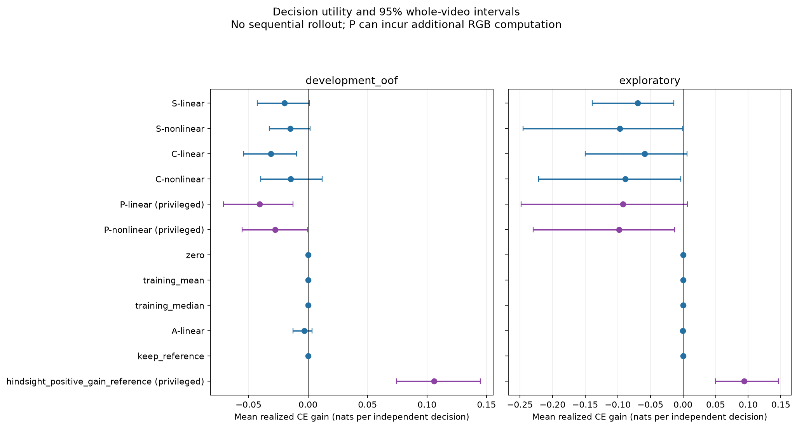
