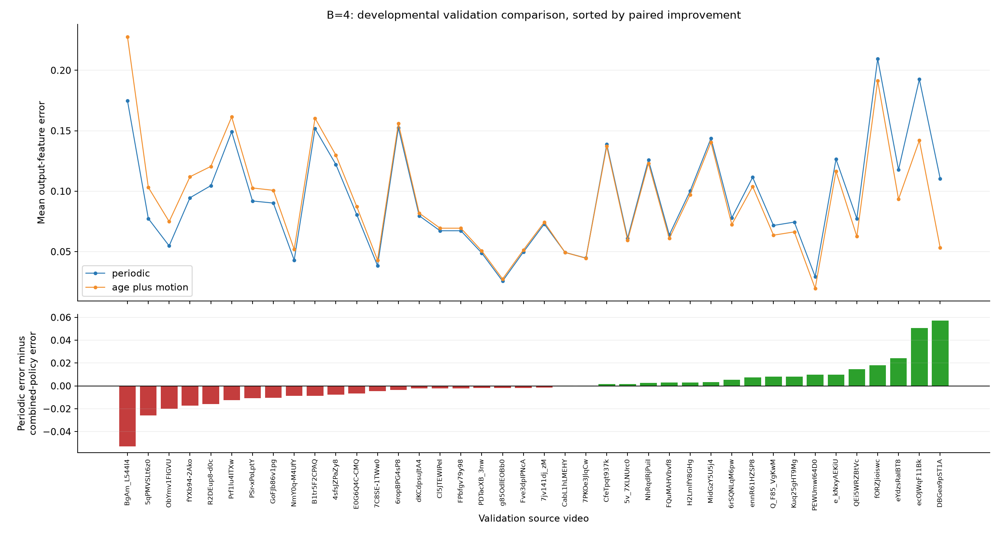
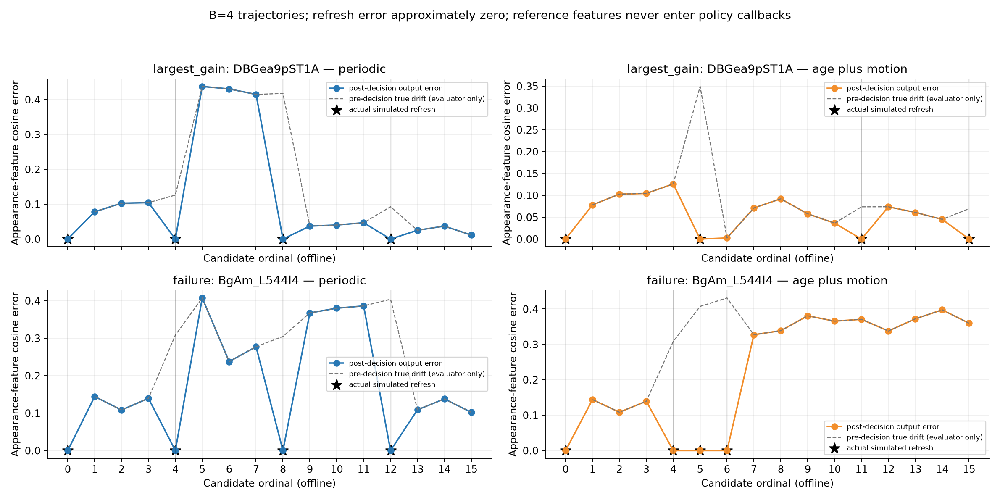

# adaptive_refresh_v1: fixed-budget offline policy replay

Actual replay began 2026-10-13T09:28:46.727895+00:00. Saved references from 120 training videos and 40 validation videos were used; zero test videos were evaluated. The training table has 14,400 cache/current pairs (120 per source video), not 14,400 independent videos. All three ridge models use the same pairs, alpha=1.0, and training-only scalers.

The protocol and threshold procedure were frozen before validation evaluation. Training-score quantiles define the grid, and one global threshold per scored policy/budget minimizes equal-weight validation-video output error. Every grid setting's forty results are saved. Models are fitted once and remain unchanged. These are **validation-tuned developmental results**, not unbiased unseen-test results or a statistical-significance claim.

## Output-feature quality

Lower error means the feature actually returned after the refresh/reuse decision is closer to the current fresh reference. Mean errors include all sixteen output positions, with approximately zero error at refreshes. Pre-decision drift is a separate evaluator-only trace field. All sparse trajectories make exactly their stated number of simulated refreshes, including candidate 0; no actual encoder executes.

Random metrics average all ten seeds within each video before giving each video equal weight. Its maximum-error metric averages trajectory maxima; worst-seed error is also saved. Seed variability is descriptive, not a confidence interval. Percentage reductions and oracle-gap closure are calculated per video before aggregation; undefined denominators remain missing and negative outcomes remain negative.

### B=2

| Policy | Mean output error | Mean candidate maximum | Mean per-video reduction vs periodic | Improved / tied / worsened | Mean oracle-gap closure | Mean forced refreshes |
| --- | ---: | ---: | ---: | --- | ---: | ---: |
| periodic | 0.134518 | 0.261740 | 0.00% | 0 / 40 / 0 | 0.00% | 0.00 |
| random | 0.139089 | 0.262771 | -5.70% | 20 / 0 / 20 | -69.30% | 0.07 |
| simple_motion | 0.141879 | 0.261089 | -8.39% | 19 / 0 / 21 | -51.44% | 0.12 |
| age_only | 0.128320 | 0.260691 | 2.65% | 27 / 2 / 11 | -43.18% | 0.10 |
| motion_only | 0.137218 | 0.252182 | -5.04% | 17 / 1 / 22 | -43.57% | 0.17 |
| age_plus_motion | 0.126060 | 0.247579 | 4.80% | 21 / 7 / 12 | 8.73% | 0.07 |
| oracle | 0.107819 | 0.226933 | 17.92% | 38 / 2 / 0 | 100.00% | 0.00 |

Oracle headroom: periodic 0.134518 versus exact offline oracle 0.107819; absolute equal-video mean headroom 0.026699, mean per-video possible reduction 17.92%. Oracle-gap closure is undefined in 2 videos at this budget.

### B=4

| Policy | Mean output error | Mean candidate maximum | Mean per-video reduction vs periodic | Improved / tied / worsened | Mean oracle-gap closure | Mean forced refreshes |
| --- | ---: | ---: | ---: | --- | ---: | ---: |
| periodic | 0.094093 | 0.232207 | 0.00% | 0 / 40 / 0 | 0.00% | 0.00 |
| random | 0.104342 | 0.244224 | -13.06% | 9 / 0 / 31 | -83.97% | 0.23 |
| simple_motion | 0.109971 | 0.246926 | -21.97% | 12 / 0 / 28 | -132.17% | 0.57 |
| age_only | 0.093565 | 0.244301 | -0.01% | 16 / 8 / 16 | -23.18% | 0.15 |
| motion_only | 0.103380 | 0.232578 | -14.62% | 13 / 0 / 27 | -100.49% | 0.80 |
| age_plus_motion | 0.093840 | 0.222195 | -0.65% | 19 / 0 / 21 | -21.31% | 0.20 |
| oracle | 0.068893 | 0.168685 | 25.36% | 40 / 0 / 0 | 100.00% | 0.05 |

Oracle headroom: periodic 0.094093 versus exact offline oracle 0.068893; absolute equal-video mean headroom 0.025200, mean per-video possible reduction 25.36%. Oracle-gap closure is undefined in 0 videos at this budget.

### B=8

| Policy | Mean output error | Mean candidate maximum | Mean per-video reduction vs periodic | Improved / tied / worsened | Mean oracle-gap closure | Mean forced refreshes |
| --- | ---: | ---: | ---: | --- | ---: | ---: |
| periodic | 0.049636 | 0.193368 | 0.00% | 0 / 40 / 0 | 0.00% | 0.00 |
| random | 0.057898 | 0.209388 | -20.77% | 7 / 0 / 33 | -85.02% | 0.74 |
| simple_motion | 0.068390 | 0.211506 | -46.48% | 7 / 0 / 33 | -171.73% | 5.22 |
| age_only | 0.051201 | 0.192773 | -4.08% | 5 / 29 / 6 | -22.54% | 1.07 |
| motion_only | 0.057836 | 0.178249 | -29.89% | 12 / 0 / 28 | -158.09% | 4.15 |
| age_plus_motion | 0.051125 | 0.170680 | -11.13% | 15 / 0 / 25 | -55.14% | 2.73 |
| oracle | 0.031980 | 0.097713 | 33.30% | 40 / 0 / 0 | 100.00% | 0.50 |

Oracle headroom: periodic 0.049636 versus exact offline oracle 0.031980; absolute equal-video mean headroom 0.017656, mean per-video possible reduction 33.30%. Oracle-gap closure is undefined in 0 videos at this budget.

Dense is a separate **B=16** reference: mean error 3.157e-17; all sixteen positions refresh.

## Does adaptive refresh help?

At B=2, age plus motion lowers equal-video mean error versus periodic by 0.008458, improving 21/40 videos and worsening 12/40. It recovers 8.73% of the per-video oracle gap on average.
Against random, combined-policy absolute mean reduction is +0.013029: 26 improved / 0 tied / 14 worsened videos.
Against simple_motion, combined-policy absolute mean reduction is +0.015820: 24 improved / 3 tied / 13 worsened videos.
Against motion_only, combined-policy absolute mean reduction is +0.011158: 23 improved / 7 tied / 10 worsened videos.
Against age_only, combined-policy absolute mean reduction is +0.002260: 18 improved / 9 tied / 13 worsened videos.
At B=4, age plus motion lowers equal-video mean error versus periodic by 0.000254, improving 19/40 videos and worsening 21/40. It recovers -21.31% of the per-video oracle gap on average.
Against random, combined-policy absolute mean reduction is +0.010502: 29 improved / 0 tied / 11 worsened videos.
Against simple_motion, combined-policy absolute mean reduction is +0.016131: 25 improved / 2 tied / 13 worsened videos.
Against motion_only, combined-policy absolute mean reduction is +0.009540: 24 improved / 3 tied / 13 worsened videos.
Against age_only, combined-policy absolute mean reduction is -0.000275: 21 improved / 0 tied / 19 worsened videos.
At B=8, age plus motion raises equal-video mean error versus periodic by 0.001490, improving 15/40 videos and worsening 25/40. It recovers -55.14% of the per-video oracle gap on average.
Against random, combined-policy absolute mean reduction is +0.006772: 26 improved / 0 tied / 14 worsened videos.
Against simple_motion, combined-policy absolute mean reduction is +0.017265: 31 improved / 3 tied / 6 worsened videos.
Against motion_only, combined-policy absolute mean reduction is +0.006711: 25 improved / 5 tied / 10 worsened videos.
Against age_only, combined-policy absolute mean reduction is +0.000076: 19 improved / 1 tied / 20 worsened videos.

Adding age beyond motion-only must be assessed as a policy comparison above; prediction MAE does not directly determine refresh quality. All-pair refitting changes the training cache-history distribution. Sequential decisions also change future ages and intervals, so the previous periodic-label prediction ranking is not a policy ranking.

Mean absolute reduction, mean per-video percentage reduction, and mean oracle-gap closure use different denominators. They can have different signs when gains and losses occur in videos with different baseline errors or oracle headroom. A ratio of aggregate errors is not the mean of per-video percentages; small oracle gaps can make individual gap-closure values very negative. These values are preserved.

## Forced spending and variability

The required rule spends the remaining budget at the end when remaining slots equal remaining refreshes. It is part of every sparse policy; forced counts are recorded separately from threshold-triggered refreshes.

age_only, B=2: mean 0.10 forced refreshes; 10.0% of trajectories have at least one; 10.0% of nonmandatory refreshes are forced.
motion_only, B=2: mean 0.17 forced refreshes; 17.5% of trajectories have at least one; 17.5% of nonmandatory refreshes are forced.
age_plus_motion, B=2: mean 0.07 forced refreshes; 7.5% of trajectories have at least one; 7.5% of nonmandatory refreshes are forced.
simple_motion, B=2: mean 0.12 forced refreshes; 12.5% of trajectories have at least one; 12.5% of nonmandatory refreshes are forced.
Random B=2 equal-video mean error ranges 0.129714–0.149593 across all ten fixed seeds.
age_only, B=4: mean 0.15 forced refreshes; 10.0% of trajectories have at least one; 5.0% of nonmandatory refreshes are forced.
motion_only, B=4: mean 0.80 forced refreshes; 30.0% of trajectories have at least one; 26.7% of nonmandatory refreshes are forced.
age_plus_motion, B=4: mean 0.20 forced refreshes; 15.0% of trajectories have at least one; 6.7% of nonmandatory refreshes are forced.
simple_motion, B=4: mean 0.57 forced refreshes; 25.0% of trajectories have at least one; 19.2% of nonmandatory refreshes are forced.
Random B=4 equal-video mean error ranges 0.097207–0.113715 across all ten fixed seeds.
age_only, B=8: mean 1.07 forced refreshes; 27.5% of trajectories have at least one; 15.4% of nonmandatory refreshes are forced.
motion_only, B=8: mean 4.15 forced refreshes; 67.5% of trajectories have at least one; 59.3% of nonmandatory refreshes are forced.
age_plus_motion, B=8: mean 2.73 forced refreshes; 75.0% of trajectories have at least one; 38.9% of nonmandatory refreshes are forced.
simple_motion, B=8: mean 5.22 forced refreshes; 85.0% of trajectories have at least one; 74.6% of nonmandatory refreshes are forced.
Random B=8 equal-video mean error ranges 0.054117–0.061246 across all ten fixed seeds.

## Recommendation

Oracle results show the fidelity improvement achievable by ideal offline scheduling under this setup. A large oracle gap with weak learned-policy recovery points to a predictor/decision-rule problem; small headroom limits the opportunity regardless of predictor quality.

The combined policy provides **no consistent improvement over periodic refresh** across the developmental results. At the primary B=4, the equal-video mean absolute change is +0.000254, but mean per-video percentage change is -0.65% and 21/40 videos worsen. The sizable oracle headroom and weak recovery point to the predictor/decision rule, rather than a lack of possible scheduling gains. A fresh-test replay can audit this fixed negative/mixed result if its thresholds remain frozen; it is not a promotion to a successful controller. **Do not proceed directly to actual GPU timing or a recognition probe for this rule.** Inspect budget allocation, exhaustion, and forced spending using training or new development data first. Do not repeatedly tune these same validation videos until the result becomes positive.

No regression, feature definition, budget rule, or threshold-grid procedure was retuned after observing these validation outcomes.

## Figures and examples






Example largest_gain: DBGea9pST1A_000016_000026 (shoveling snow), absolute B=4 reduction +0.057209. Selected by the frozen largest-gain/largest-loss rule, with video-ID tie break, for description only.
Example failure: BgAm_L544l4_000083_000093 (petting cat), absolute B=4 reduction -0.052910. Selected by the frozen largest-gain/largest-loss rule, with video-ID tie break, for description only.

## Limits and reproduction

Thresholds were selected on these same forty validation videos; this is developmental evidence. Appearance-feature fidelity is not action-recognition accuracy. Replay measures no codec, motion-processing, controller, transfer, or GPU execution latency. Counts are simulated refreshes/logical encoder calls, not actual encoder executions. Future-reference codec vectors and full-clip candidate selection make this offline, despite sequential access to current/preceding motion descriptors. The oracle uses all reference features and is an unavailable offline diagnostic bound. Sixteen low-resolution candidates, one appearance encoder, and twenty source classes limit generalization. Candidate observations and random seeds are correlated within each of forty videos; no confidence intervals or significance claims are made.

Run from the repository root in the existing environment:

```powershell
& .\.venv\Scripts\python.exe .\replay_refresh_policies.py --input results/cache_drift_v2 --output results/adaptive_refresh_v1 --budgets 2 4 8 --seed 20261013
```

Completed/existing outputs are preserved by choosing a fresh directory. For saved-CSV audits use `float_precision='round_trip'`. See `protocol.json`, `metadata.json`, `train_pairs.csv`, `fitted_predictors.json`, `threshold_grid.json`, `threshold_search.csv`, `selected_thresholds.json`, `policy_traces.csv`, `validation_trajectories.csv`, `validation_per_video_metrics.csv`, `validation_pairwise_comparisons.csv`, `validation_aggregate_metrics.json`, `oracle_schedules.json`, and `verification.json`.
