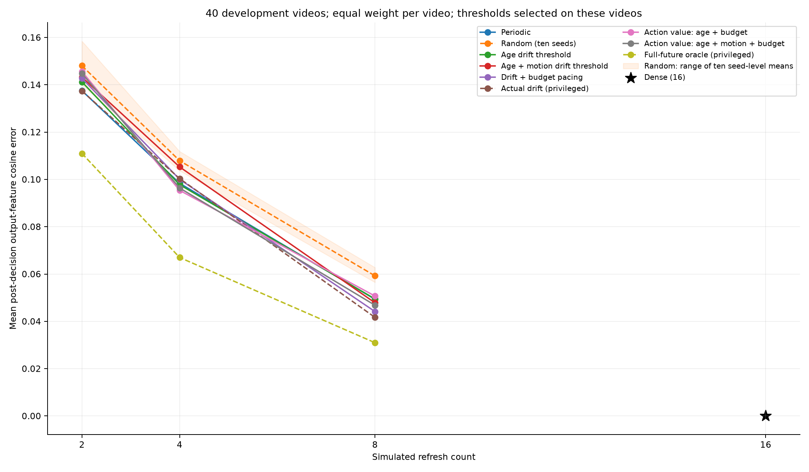
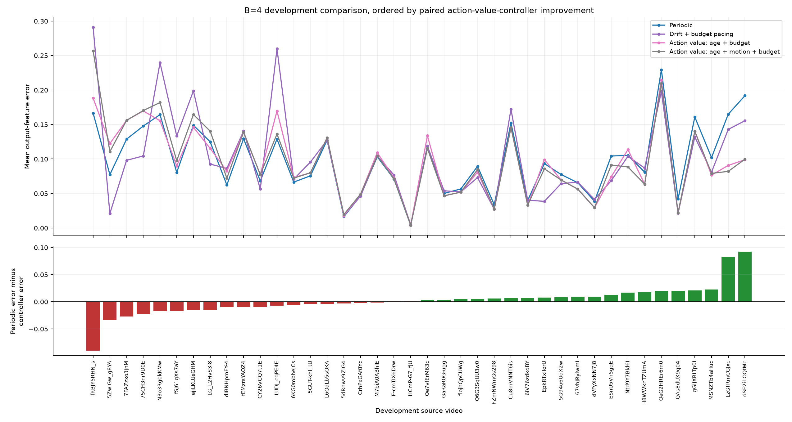
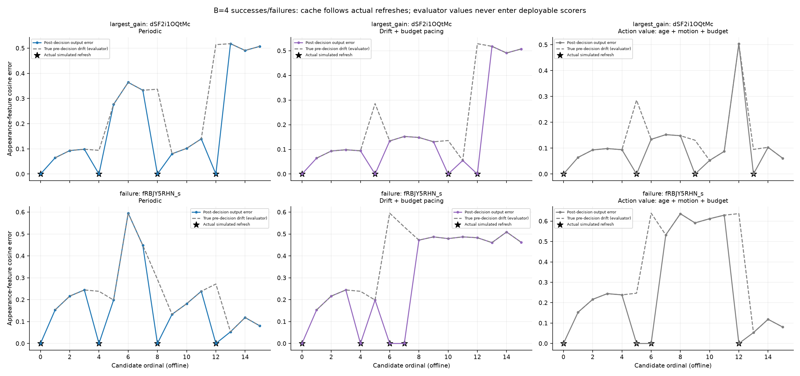

# Budget-aware oracle-action-value refresh: development findings

Actual execution started 2026-10-14T04:12:45.435316+00:00 (UTC); client research date 2026-10-14. This is saved-artifact offline replay.

## Data and frozen methods

Only the original 120 v2 training sources were used: four training and two development videos per class, seed 20261014, yielding **80 training /40 development videos**. Original validation/test feature arrays, motion tables, predictions and evaluation results were not loaded. Identity manifests and preservation hashes are separate from data access.
The same eighty sources train both drift baselines (**9,600 pairs**) and six budget-specific action-value regressors (**32,480 optional states**). Scalers use training-only population statistics, alpha=1.0, unpenalized intercept, float64 arithmetic. State counts are equal within each budget across training videos.

An exact DP minimizes remaining SUM of output errors with exactly b refreshes. The signed label `(Q_reuse-Q_refresh)/16` is generated only for reachable states with both actions feasible. Future RGB generates training labels, never deployable inputs. Optional action-value decisions refresh iff predicted advantage >0; no clipping, threshold search or retraining occurs for these models.

Drift thresholds and the four predefined pacing lambdas are selected globally on these same forty development videos. All candidates, settings and tie rules were frozen beforehand. Pacing lambda=0 reproduces static decisions. Random averages all ten fixed seeds within each video. Mandatory refresh0 and exact B constraints apply to all sparse methods. Dense is a separate B=16 reference.

## Results

Lower mean post-decision cosine error is better; every video has equal weight.

| Policy | B=2 | B=4 | B=8 |
| --- | ---: | ---: | ---: |
| Periodic | 0.137533 | 0.098383 | 0.049331 |
| Random (ten seeds) | 0.148065 | 0.107923 | 0.059255 |
| Age drift threshold | 0.141244 | 0.097781 | 0.049480 |
| Age + motion drift threshold | 0.143249 | 0.105307 | 0.047850 |
| Drift + budget pacing | 0.142781 | 0.100075 | 0.044148 |
| Actual drift (privileged) | 0.137411 | 0.100359 | 0.041695 |
| Action value: age + budget | 0.145639 | 0.095387 | 0.050709 |
| Action value: age + motion + budget | 0.144809 | 0.096393 | 0.046827 |
| Full-future oracle (privileged) | 0.111000 | 0.067008 | 0.030979 |

Dense B=16 mean error: 3.348e-17 (approximately zero). Refresh counts are simulated logical calls; **actual encoder executions=0**.

Primary B=4 comparison. Percentage improvements are computed separately per video before averaging.

| Policy | Mean error | Mean absolute gain vs periodic | Mean per-video gain (%) | Improved/tied/worsened | Mean oracle-gap closure (%) |
| --- | ---: | ---: | ---: | --- | ---: |
| Periodic | 0.098383 | 0.000000 | 0.00 | 0/40/0 | 0.00 |
| Random (ten seeds) | 0.107923 | -0.009540 | -10.76 | 14/0/26 | -66.34 |
| Age drift threshold | 0.097781 | 0.000602 | -1.76 | 14/9/17 | -29.96 |
| Age + motion drift threshold | 0.105307 | -0.006924 | -4.82 | 21/1/18 | -73.57 |
| Drift + budget pacing | 0.100075 | -0.001692 | -0.52 | 19/2/19 | -64.54 |
| Actual drift (privileged) | 0.100359 | -0.001976 | -9.97 | 16/0/24 | -93.22 |
| Action value: age + budget | 0.095387 | 0.002996 | 2.22 | 20/0/20 | -13.60 |
| Action value: age + motion + budget | 0.096393 | 0.001991 | 1.97 | 20/0/20 | -16.53 |
| Full-future oracle (privileged) | 0.067008 | 0.031375 | 30.39 | 40/0/0 | 100.00 |

Absolute means, mean per-video percentages, and mean per-video oracle-gap closures have different denominators and can differ in sign. Ratios of aggregate means are not mean per-video percentages. Negative values are retained; zero/small denominators are missing with reasons. The oracle is a full-future lower bound; privileged actual-drift thresholding is **not** a bound or deployable method.

## Does budget-aware action supervision help?

B=4: action value with motion has mean absolute improvement versus periodic +0.001991, mean per-video percentage 1.97%; 20 improved, 0 tied, 20 worsened videos.
Versus Drift + budget pacing: mean absolute improvement +0.003683; 22/0/18 improved/tied/worsened; mean per-video percentage -11.32%.
Versus Action value: age + budget: mean absolute improvement -0.001006; 11/17/12 improved/tied/worsened; mean per-video percentage -0.76%.
Versus Age + motion drift threshold: mean absolute improvement +0.008914; 23/0/17 improved/tied/worsened; mean per-video percentage -6.36%.
Privileged actual-drift threshold versus predicted-drift static threshold: mean absolute improvement +0.004948; 10/3/27. A weak actual-drift threshold despite oracle headroom implicates the greedy threshold rule; a large privileged/predicted gap implicates prediction as well.
Oracle mean headroom 0.031375; mean per-video possible reduction 30.39%; undefined oracle gaps 0.
B=2: action value with motion has mean absolute improvement versus periodic -0.007276, mean per-video percentage -7.41%; 16 improved, 0 tied, 24 worsened videos.
Versus Drift + budget pacing: mean absolute improvement -0.002028; 17/0/23 improved/tied/worsened; mean per-video percentage -8.41%.
Versus Action value: age + budget: mean absolute improvement +0.000830; 14/15/11 improved/tied/worsened; mean per-video percentage 0.97%.
Versus Age + motion drift threshold: mean absolute improvement -0.001560; 19/0/21 improved/tied/worsened; mean per-video percentage -7.26%.
Privileged actual-drift threshold versus predicted-drift static threshold: mean absolute improvement +0.005838; 18/7/15. A weak actual-drift threshold despite oracle headroom implicates the greedy threshold rule; a large privileged/predicted gap implicates prediction as well.
Oracle mean headroom 0.026532; mean per-video possible reduction 17.66%; undefined oracle gaps 3.
B=8: action value with motion has mean absolute improvement versus periodic +0.002504, mean per-video percentage 3.63%; 22 improved, 3 tied, 15 worsened videos.
Versus Drift + budget pacing: mean absolute improvement -0.002679; 16/0/24 improved/tied/worsened; mean per-video percentage -13.39%.
Versus Action value: age + budget: mean absolute improvement +0.003882; 23/4/13 improved/tied/worsened; mean per-video percentage 5.63%.
Versus Age + motion drift threshold: mean absolute improvement +0.001023; 22/0/18 improved/tied/worsened; mean per-video percentage -8.31%.
Privileged actual-drift threshold versus predicted-drift static threshold: mean absolute improvement +0.006155; 22/4/14. A weak actual-drift threshold despite oracle headroom implicates the greedy threshold rule; a large privileged/predicted gap implicates prediction as well.
Oracle mean headroom 0.018352; mean per-video possible reduction 35.19%; undefined oracle gaps 0.

At B=4, adding motion raises mean error relative to age/budget alone by 0.001006. The controller beats pacing in average development error. Mixed per-video counts above must be assessed alongside means; no significance is claimed.

## Early spending, delayed spending, and approximation error

The evaluator logs both feasible oracle action values. Positive regret on a refresh identifies a costly spend-now decision; positive regret on reuse identifies a costly delay. Summed regrets reproduce the policy mean-error excess over the exact oracle. Future oracle values are diagnostic only. Forced-refresh counts by themselves do not establish success.

| Policy | B | Mean forced refreshes | Mean last refresh | Mean outputs after exhaustion | Mean summed action regret |
| --- | ---: | ---: | ---: | ---: | ---: |
| Age + motion drift threshold | 2 | 0.10 | 6.72 | 8.28 | 0.032249 |
| Drift + budget pacing | 2 | 0.00 | 6.38 | 8.62 | 0.031780 |
| Action value: age + budget | 2 | 0.00 | 12.47 | 2.52 | 0.034639 |
| Action value: age + motion + budget | 2 | 0.00 | 11.80 | 3.20 | 0.033809 |
| Age + motion drift threshold | 4 | 0.38 | 11.35 | 3.65 | 0.038299 |
| Drift + budget pacing | 4 | 0.07 | 11.38 | 3.62 | 0.033067 |
| Action value: age + budget | 4 | 0.00 | 14.00 | 1.00 | 0.028379 |
| Action value: age + motion + budget | 4 | 0.10 | 13.97 | 1.02 | 0.029385 |
| Age + motion drift threshold | 8 | 3.35 | 13.78 | 1.23 | 0.016871 |
| Drift + budget pacing | 8 | 0.57 | 13.85 | 1.15 | 0.013169 |
| Action value: age + budget | 8 | 0.30 | 14.30 | 0.70 | 0.019730 |
| Action value: age + motion + budget | 8 | 0.82 | 14.82 | 0.17 | 0.015848 |
Action value: age + budget B=4: 38 costly refresh decisions (total regret 0.203664) and 151 costly reuse decisions (total regret 0.931485) across forty videos.
Largest action-regret example: 5ZwiGw_g8YA, candidate 9, cached 5, remaining 2, action refresh, reason positive_advantage, predicted score 0.000881, regret 0.041009.
Action value: age + motion + budget B=4: 36 costly refresh decisions (total regret 0.205525) and 160 costly reuse decisions (total regret 0.969856) across forty videos.
Largest action-regret example: 5ZwiGw_g8YA, candidate 9, cached 4, remaining 2, action refresh, reason positive_advantage, predicted score 0.001775, regret 0.040969.
Drift + budget pacing B=4: 54 costly refresh decisions (total regret 0.889214) and 92 costly reuse decisions (total regret 0.433481) across forty videos.
Largest action-regret example: LUDJ_eqPE4E, candidate 5, cached 4, remaining 1, action refresh, reason threshold_refresh, predicted score 0.208742, regret 0.113479.
Age + motion drift threshold B=4: 51 costly refresh decisions (total regret 1.111191) and 90 costly reuse decisions (total regret 0.420754) across forty videos.
Largest action-regret example: 7FAZzxo3jnM, candidate 5, cached 4, remaining 1, action refresh, reason threshold_refresh, predicted score 0.233680, regret 0.195759.
Timeline largest_gain: dSF2i1OQtMc (skipping rope), B4 gain +0.092129; chosen by the frozen descriptive rule.
Timeline failure: fRBJY5RHN_s (shoveling snow), B4 gain -0.090263; chosen by the frozen descriptive rule.

## Recommendation and limits

The development mean supports a frozen fresh-video confirmation of the proposed controller against periodic, pacing and age/budget controls. This is preliminary evidence, with per-video losses retained; it does not justify recognition or timing claims. Run the predefined hundred-video confirmation without retuning before considering those later experiments.

Failure applies to these input definitions, ridge models, targets and rules; it does not prove every adaptive policy must fail. Development settings were selected on evaluated development videos. Features measure appearance fidelity, not action-recognition accuracy. Replay measures no decoding, controller, motion-processing, transfer or GPU latency. Full-clip candidate selection and future-reference codec vectors make this offline. Oracle labels use privileged future RGB during training. Many states from one source are correlated, not independent videos. No confidence intervals, significance, accuracy or speedup estimates are manufactured.

The frozen prospective `fresh_test_protocol.json` requires **100 new videos, five per existing class**, excluding all prior source IDs and duplicate hashes. It fixes these models/settings and paired whole-video uncertainty estimation. That set was not acquired or evaluated.

## Plots and reproduction







Run from the repository root with the existing environment:

```powershell
& .\.venv\Scripts\python.exe .\replay_budget_aware_policies.py --input results/cache_drift_v2 --output results/budget_aware_refresh_v2 --budgets 2 4 8 --seed 20261014
```

Existing completed and partial directories are preserved by choosing a fresh directory. Scientific missing values are blank in CSV and null in JSON; use round-trip float parsing for audits. See protocol, split, training tables, predictor parameters, all threshold results, traces, per-video metrics, aggregate metrics, oracle verification and verification files.
