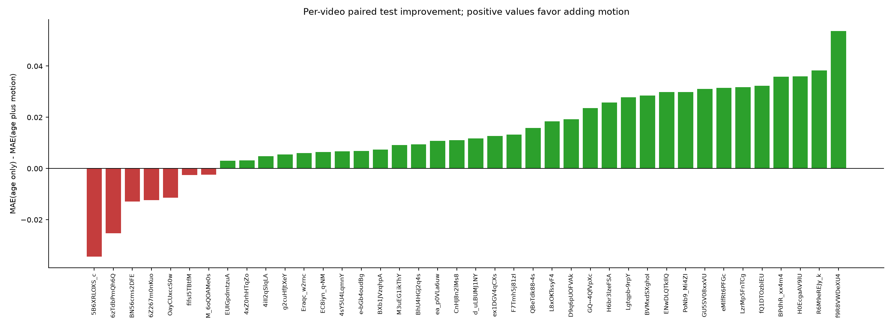
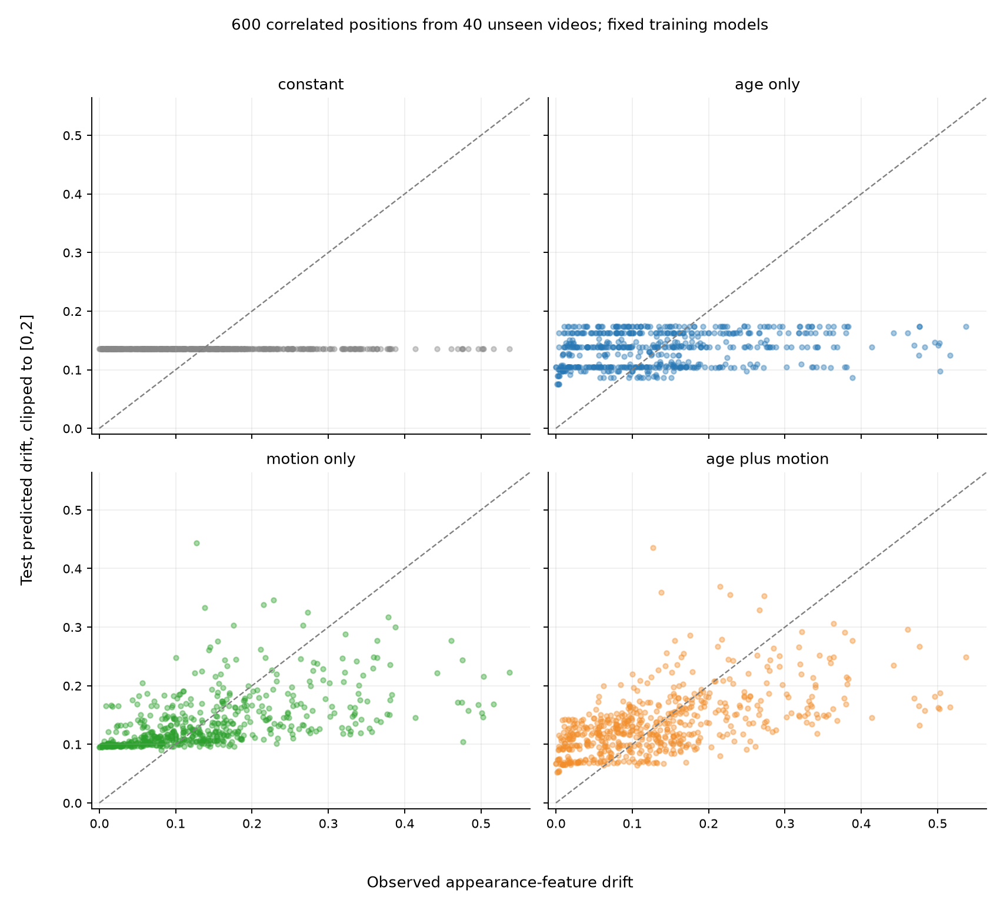

# cache_drift_v2: previously unseen-video prediction

Real CUDA collection: 2026-10-12T12:09:29.237736+00:00 through 2026-10-12T12:14:00.449444+00:00. 200 new Kinetics-400 source videos from 20 classes, with 120/40/40 custom training/validation/test videos. 3,200 reference features and 3,000 pre-decision drift labels; 600 test positions within 40 independent source videos. Original ten pilot sources are excluded.

The sampling plan, eligibility, split, alpha=1.0, input definitions, comparisons, and bootstrap protocol were fixed before test evaluation. All four models and training-only scalers are fitted on the same 1,800 training observations; validation never changes parameters. The predefined lowest-validation-MAE rule nominates **age_plus_motion** for subsequent research, before inspecting test results. Primary metrics use [0,2]-clipped predictions; raw predictions and clipping counts are saved.

## Test prediction quality

Smaller MAE/RMSE indicates more accurate drift magnitude prediction. Spearman measures whether larger predicted drift corresponds to larger observed drift within a video. Undefined constant-target/prediction correlations are missing, not zero; Spearman aggregates include only defined per-video values.

| Predictor | Mean MAE | Median MAE | Mean RMSE | Median RMSE | Mean Spearman | Median Spearman | Undefined rho | Clipped predictions |
| --- | ---: | ---: | ---: | ---: | ---: | ---: | ---: | ---: |
| constant | 0.082098 | 0.066609 | 0.093629 | 0.075827 | undefined | undefined | 40 | 0 |
| age_only | 0.080349 | 0.071062 | 0.092088 | 0.079348 | 0.4254 | 0.4447 | 0 | 0 |
| motion_only | 0.068331 | 0.057542 | 0.080524 | 0.070241 | 0.4179 | 0.4679 | 0 | 0 |
| age_plus_motion | 0.066963 | 0.058671 | 0.078713 | 0.066786 | 0.4822 | 0.5821 | 0 | 0 |

## Predefined paired comparisons

Positive differences are MAE(reference) minus MAE(candidate), calculated per video before averaging. 95% percentile intervals use 10,000 whole-source-video paired resamples with seed 20261013 and fixed fitted models. They describe uncertainty over held-out videos conditional on these models, not uncertainty from training-set or class selection. Candidate positions are not independently resampled.

| Candidate versus reference | Mean absolute improvement | 95% bootstrap interval | Mean per-video % improvement | Improved / tied / worsened | Interpretation |
| --- | ---: | --- | ---: | --- | --- |
| age_plus_motion vs age_only | +0.013386 | [+0.007743, +0.018699] | 11.76% | 33 / 0 / 7 | improvement |
| motion_only vs constant | +0.013767 | [+0.008163, +0.019157] | 8.37% | 34 / 0 / 6 | improvement |
| motion_only vs age_only | +0.012018 | [+0.006721, +0.017169] | 10.26% | 33 / 0 / 7 | improvement |
| age_plus_motion vs constant | +0.015135 | [+0.008274, +0.021785] | 7.17% | 32 / 0 / 8 | improvement |
| age_plus_motion vs motion_only | +0.001368 | [-0.000709, +0.003418] | 1.25% | 23 / 0 / 17 | inconclusive |

Adding motion beyond age is **improvement** under the primary comparison: 33/40 videos improve and 7/40 worsen. Median paired absolute improvement is +0.011392; median per-video percentage improvement is 16.30%.

The largest two positive gains (f9R8VWDeXU4_000049_000059, R6M9eREJy_k_000004_000014) account for 17.18% of net summed improvement. This descriptive net-gain percentage can exceed 100% if losses offset gains. The per-video plot shows whether gains are broadly distributed.
motion_only compared with constant: **improvement**, with 34/40 improved videos and conditional interval [+0.008163, +0.019157].
motion_only compared with age_only: **improvement**, with 33/40 improved videos and conditional interval [+0.006721, +0.017169].
age_plus_motion compared with constant: **improvement**, with 32/40 improved videos and conditional interval [+0.008274, +0.021785].
age_plus_motion compared with motion_only: **inconclusive**, with 23/40 improved videos and conditional interval [-0.000709, +0.003418].
The paired MAE difference between motion-only and age plus motion is inconclusive.

Mean defined per-video ranking correlation is 0.4822 for age plus motion, 0.4254 for age only, and 0.4179 for motion only. Numerical-error improvement and ranking improvement must be assessed separately.

## Recommendation and limits

The fixed motion inputs show broadly distributed magnitude and ranking improvements beyond age on this custom test set. This supports a separate adaptive-policy experiment, with new held-out videos, recognition accuracy, and actual refresh/latency measurements. No controller is implemented here.

Collection recorded 53669 frames, 53140 with vectors and 529 without, and 50482464 future-reference entries among 148409503 vectors. Motion is a simple CPU codec-displacement summary, not optical flow, physical velocity, or a learned motion-recognition branch. Missing-vector frames remain valid with zero summaries and explicit availability.

Existing B-frames/future-reference vectors make this an offline diagnostic, despite aggregating only current/preceding decoded positions. Original bytes are preserved; a controlled I/P-only experiment is separate. Appearance-feature drift is not action-recognition error or measured refresh benefit. Better drift prediction does not establish maintained recognition accuracy or adaptive-refresh speedup.

This is a custom diagnostic subset from a seeded prefix of CVDF official validation archives, not an official full-dataset recognition evaluation. Twenty selected classes, 40 test videos, one encoder and one encoding distribution limit generalization. Bootstrap intervals do not include fitting or sampling uncertainty. No feature, alpha, or model tuning used test outcomes. Validation's candidate nomination is exploratory, not proof of policy effectiveness.

## Audit artifacts

See `sampling_plan.json`, `dataset_manifest.json`, `split_manifest.json`, `acquisition.json`, `exclusions.json`, `collection_metadata.json`, `features/`, `motion_frames/`, `observations.csv`, `fitted_predictors.json`, `validation_predictions.csv`, `test_predictions.csv`, `per_video_metrics.csv`, `paired_comparisons.csv`, `bootstrap_intervals.json`, `aggregate_metrics.json`, and `verification.json`. All original experiment sources/snapshots and release validation remain intact. Dataset archives, videos, and pretrained weights are excluded from Git.
