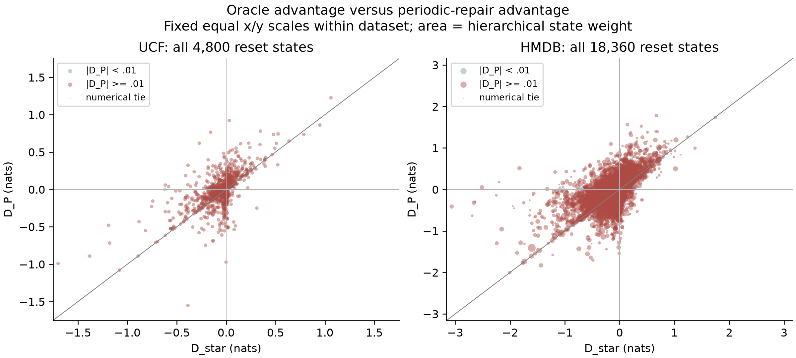
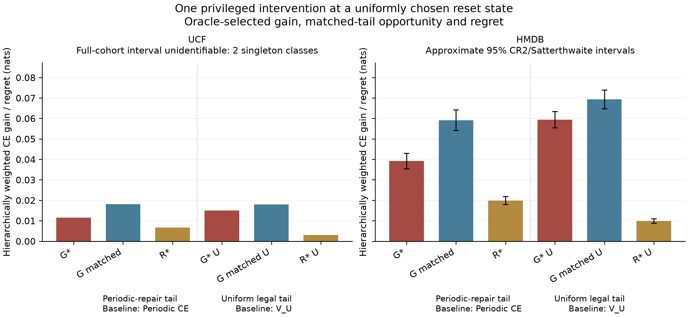
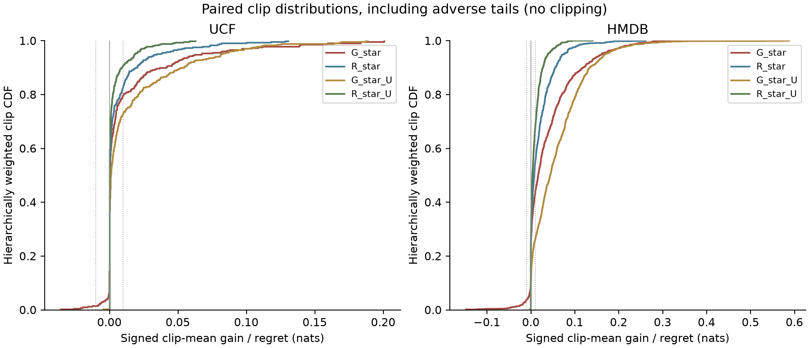

# Experiment 25 — continuation value gap

This is an offline, label/future-informed diagnostic. UCF is exposed development; raw CE is never pooled across datasets. Each clip averages 12 alternative SINGLE interventions at reset Periodic prefixes, not a rollout of oracle actions.

|Dataset|Execution|G_star (nats)|95% interval|Inferential outcome|
|---|---|---:|---|---|
|UCF|COMPLETE|0.011475861|None|No inferential label: uncertainty unavailable|
|HMDB|COMPLETE|0.0392498027|[0.03545577584700567, 0.043043829576159834]|material benefit|

UCF retains all 400 clips, 101 fixed classes and 200 class-scoped groups. BenchPress and JavelinThrow each have one group: the full-cohort CR2 interval is unidentifiable. No substitute narrow interval is reported.

|Endpoint (nats)|UCF|HMDB|
|---|---:|---:|
|G_star|0.011475860952519814|0.03924980271158275|
|G_matched|0.01808464591107954|0.05914647908583846|
|R_star|0.006608784958559725|0.019896676374255715|
|G_star_U|0.014959803085597643|0.0594406465326759|
|G_matched_U|0.017997504062608385|0.06937210183036034|
|R_star_U|0.003037700977010744|0.009931455297684452|
|G_Z_pool|0.0002653144131738098|0.0038993159331623664|
|Dense_CE|0.2443242951434414|1.5142440280089988|
|Periodic_CE|0.24742722945955992|1.5982434212043402|
|Task_oracle_CE|0.13548268541350722|1.1807795864855506|

## UCF paired consequences

Accuracy: Dense 93.5644%, Periodic 94.3069%, oracle-selected single intervention 94.4101%; correct-to-wrong 0.1238%, wrong-to-correct 0.2269%. Accuracy averages individual complete-schedule indicators; no intervention ensemble.

All-state and material-margin disagreement denominators and paired regret: `ucf/estimates.json`. Weighted quantiles, material harm/benefit fractions, class estimates and leave-one-family-out results accompany the complete state/clip tables.

Clip-mean gain >=.01: 20.5446% weighted mass (83/400 clips); gain <=-.01: 1.4851% (6/400).

Primary df: None; component concentration: {'maximum_weight': 0.009900990099009901, 'sum_squared_weights': 0.005048524654445643, 'effective_components': 198.0776699029126}.

## HMDB paired consequences

Accuracy: Dense 57.6281%, Periodic 57.3541%, oracle-selected single intervention 58.2897%; correct-to-wrong 0.1946%, wrong-to-correct 1.1302%. Accuracy averages individual complete-schedule indicators; no intervention ensemble.

All-state and material-margin disagreement denominators and paired regret: `hmdb/estimates.json`. Weighted quantiles, material harm/benefit fractions, class estimates and leave-one-family-out results accompany the complete state/clip tables.

Clip-mean gain >=.01: 56.8258% weighted mass (814/1530 clips); gain <=-.01: 3.5978% (52/1530).

Primary df: 238.11144054355847; component concentration: {'maximum_weight': 0.01191048314750737, 'sum_squared_weights': 0.0027886209288848374, 'effective_components': 358.600191815923}.

## Validation gate and resources

```json
{
  "status": "COMPLETE",
  "smoke_clips": 8,
  "smoke_seconds": [
    1.6028460999996241,
    1.3716300999994928,
    0.9084473000002617,
    1.1084215000000768,
    1.0502803999997923,
    1.021884200000386,
    1.01197030000003,
    1.095534499999303
  ],
  "conservative_seconds_per_clip": 2.404269149999436,
  "projected_total_collection_seconds": 10289.825899797588,
  "wall_cap_seconds": 28800,
  "projected_additional_bytes": 654996034,
  "disk_cap_bytes": 21474836480,
  "available_disk_bytes": 96335282176,
  "expected_new_snippet_forwards": 68544,
  "smoke_forwards_reused": 128,
  "measured_cumulative_seconds": 9.171014399998967,
  "at_utc": "2026-10-21T05:56:59.840956+00:00",
  "actual_collection_seconds": 4411.288931500015,
  "additional_bytes": 371433444,
  "completed_at_utc": "2026-10-21T09:01:24.882293+00:00"
}
```

Actual collection events, failed starts/completions, decode/write-inclusive elapsed times, resume reuse and setup/check calls are in `exposure_resource_ledger.jsonl` and `collection_resources.json`. CPU analysis/collection durations are diagnostic resource use, not deployed latency.

## Interpretation and next decision

Positive matched gain and regret are nonnegative by construction; their existence is not a success. The sign and magnitude of G_star measure dependence on this exact continuation. Small effects cannot establish that adaptive scheduling is impossible. Effects under uniform and periodic-repair tails have different baselines and only support continuation-specific claims.

The defensible contribution is an exact empirical diagnosis of how optimistic task-oracle action preferences transport to two fixed continuation rules in budgeted video inference. It is not a new general sequential-learning principle, a learned policy, evidence that observations predict the advantage, or a speedup.

The old H/H+M controllers used Z_pool; no historical failure is attributed to training on D_star. Experiments 19/19.1/23A/23B remain unchanged. HMDB (when evaluated) is previously task-outcome-unexposed under isolation of known conservative source components, conditional on a fixed head. Unknown parent identities, reuploads and pretraining overlap remain uncertain. The adaptive frame-index HMDB recipe differs physically from UCF sampling; semantic domain is not the sole difference.

Next scientific action: inspect the signed primary estimate together with matched-tail opportunity and regret, then resolve the stated fresh-evaluation gate if HMDB did not run. Do not fit another controller or tune a head using these outcomes. A new controller study would require a new prospective protocol and separate outcome-unexposed data.

## Claim-to-evidence

|Claim|Evidence|Limit|
|---|---|---|
|Exact oracle versus fixed-tail action consequences|per_state.csv.gz; sealed outcome_table.npz; independent_verification.json|Privileged labels/future outcomes; single intervention|
|Distribution and classification consequences|per_clip.csv; estimates.json; figure_3_distributions|Fixed head and classes; CE is not error|
|Continuation sensitivity|Q_U exact branch means, V_U, uniform endpoints|Different whole-tail baseline|
|Provenance and execution|design/population/evaluation seals; ledgers; manifests|Unknown source and pretraining dependencies|

## Related methodology

Ross and Bagnell, [AggreVaTe section 2.5](https://arxiv.org/html/1406.5979v1), discuss overly optimistic expert cost-to-go when a learner cannot execute the same recovery. Our diagnostic tests a related assumption with exact finite schedule outcomes; it does not claim to discover that general issue.

Approximate small-sample cluster-robust uncertainty follows [Pustejovsky and Tipton](https://doi.org/10.1080/07350015.2016.1247004), the [corrigendum](https://doi.org/10.1080/07350015.2023.2174123), and current official [CR2](https://jepusto.github.io/clubSandwich/reference/vcovCR.html) / [Satterthwaite contrast](https://jepusto.github.io/clubSandwich/reference/linear_contrast.html) documentation. Intervals condition on fixed head/classes and assumed independent global components, omit training uncertainty, and have no exact finite-sample coverage guarantee. Zero empirical variance cannot prove equivalence. Secondary intervals are descriptive and unadjusted.

## Observed resources and verification

UCF CPU endpoint calculation: 19.82 s; zero new encoder calls, decodes or fits. HMDB collection: 4411.288931500015 s including per-clip reads, decode, preprocessing, inference, synchronization and writes. Forward starts/completions: 68,544/68,544. Additional retained disk: 354.48 MiB. The resource ledger includes the successful first smoke clip before the timestamp bookkeeping failure and its hash-verified reuse; that mechanical failure and original code/seal are retained. No failed model forward is hidden.

The existing `.venv_temporal` executable uses the already configured shared `.venv` Torch/torchvision libraries; actual paths and versions are in `actual_runtime_paths.json`. No environment was replaced or upgraded. CPU-analysis peak RAM was not separately measured. Smoke GPU and sampled adapter peak RAM are reported with their measurement scope in `resource_summary.json`.

The per-clip timer sum is distinct from the conservative elapsed collection envelope: 11053.44 s (3.0704 h). The envelope includes directory/hash bookkeeping outside clip timers, restart gaps, and head fitting, so it bounds the complete feature-collection wall time conservatively. Cap compliance is also checked against this broader window; neither quantity is deployed adaptive-inference latency.

Input-only physical support: UCF snippet-span median 1.6 s versus HMDB EVAL 1.267 s; HMDB EVAL 5th–95th percentile snippet spans 0.1333–1.567 s. Median candidate gaps are 0.32 s (UCF) and 0.1667 s (HMDB). These are unweighted metadata distributions over all included clips/snippets, not independent outcome replicates. Complete probabilities/denominators are in `temporal_support.json`.

Independent artifact verification passed: True; historical result blobs preserved: 4652. Suffix enumeration, scalar state reconstruction, E22 overlap and all455 scalar raw-feature checks on fixed hash-selected real clips are separate from synthetic fixture validation.

- UCF: 4,800 real state values; max scalar state discrepancy 2.66e-15 nats; raw-feature replay on 3 clips/all455 schedules: max CE discrepancy 1.42e-14 nats.
- HMDB: 18,360 real state values; max scalar state discrepancy 3.55e-15 nats; raw-feature replay on 3 clips/all455 schedules: max CE discrepancy 7.99e-15 nats.

## UCF diagnostics and meaning

Accounting check: r_a=Q_P(a)-Q_star(a) has minimum 0 nats; max residual in D_P-D_star=r_HOLD-r_REFRESH is 0 nats. Different action-specific continuation gaps explain how an optimistic branch preference can change under a fixed tail. This is an accounting verification, not a new theorem. Exact branch cardinalities are in `branch_sizes.csv`; their differences are genuine feasible-space differences, not Monte Carlo or noisy-minimum bias. Uniform branch means average individual schedule losses.

- P tail, all: 1181/4800 state disagreements; hierarchical fraction 24.4843%; conditional paired wrong-branch loss 0.0269919 nats; whole-cohort regret contribution 0.006608785 nats.
- P tail, material: 344/1648 state disagreements; hierarchical fraction 20.7957%; conditional paired wrong-branch loss 0.08969265 nats; whole-cohort regret contribution 0.006382831 nats.
- U tail, all: 765/4800 state disagreements; hierarchical fraction 15.9241%; conditional paired wrong-branch loss 0.01907613 nats; whole-cohort regret contribution 0.003037701 nats.
- U tail, material: 200/1631 state disagreements; hierarchical fraction 12.2796%; conditional paired wrong-branch loss 0.06923921 nats; whole-cohort regret contribution 0.002884967 nats.

Leave-one-global-family-out G_star range 0.010747761 to 0.012203961 nats; 2 omissions would remove a fixed class and remain undefined. This is influence analysis, not a replacement confidence interval.

Numerical ties: 0/4800 states. Sensitivity G_star range 0.01147586047 to 0.01147586095 nats. Primary tie-choice gain range: 0.01147586095 to 0.01147586095 nats.

Matched single-intervention CE is 0.229342584; the 455-schedule task oracle CE is 0.135482685. These have different intervention freedom. Z_pool gain uses the original centered-logit pooled-squared-error teacher, lexicographic first within1e-12, under exactly the same prefix/tail.

## HMDB diagnostics and meaning

Accounting check: r_a=Q_P(a)-Q_star(a) has minimum 0 nats; max residual in D_P-D_star=r_HOLD-r_REFRESH is 0 nats. Different action-specific continuation gaps explain how an optimistic branch preference can change under a fixed tail. This is an accounting verification, not a new theorem. Exact branch cardinalities are in `branch_sizes.csv`; their differences are genuine feasible-space differences, not Monte Carlo or noisy-minimum bias. Uniform branch means average individual schedule losses.

- P tail, all: 4250/18360 state disagreements; hierarchical fraction 23.1161%; conditional paired wrong-branch loss 0.08607289 nats; whole-cohort regret contribution 0.01989668 nats.
- P tail, material: 2750/13048 state disagreements; hierarchical fraction 21.4832%; conditional paired wrong-branch loss 0.1258538 nats; whole-cohort regret contribution 0.01970927 nats.
- U tail, all: 3028/18360 state disagreements; hierarchical fraction 16.8669%; conditional paired wrong-branch loss 0.05888139 nats; whole-cohort regret contribution 0.009931455 nats.
- U tail, material: 1881/13371 state disagreements; hierarchical fraction 14.8681%; conditional paired wrong-branch loss 0.0884003 nats; whole-cohort regret contribution 0.009797001 nats.

Leave-one-global-family-out G_star range 0.038654309 to 0.03949996 nats; 0 omissions would remove a fixed class and remain undefined. This is influence analysis, not a replacement confidence interval.

Numerical ties: 0/18360 states. Sensitivity G_star range 0.03924980271 to 0.03924980274 nats. Primary tie-choice gain range: 0.03924980271 to 0.03924980271 nats.

Matched single-intervention CE is 1.53909694; the 455-schedule task oracle CE is 1.18077959. These have different intervention freedom. Z_pool gain uses the original centered-logit pooled-squared-error teacher, lexicographic first within1e-12, under exactly the same prefix/tail.

## Precise research decision

The fixed head reached the predeclared 2,000-iteration cap in 194.25 seconds (3,756 closure calls). Its independent objective was 0.1694056696 and maximum absolute gradient 2.57914e-7, so it passed the prospective finite/gradient <=1e-6 acceptance rule. This is numerical acceptance of the fixed capped fit, not a claim that the optimizer reached its tighter 1e-9 gradient target. There was exactly one optimization attempt and no test-based head adjustment.

Recognition context: Dense top1=57.6281%. HEAD_TRAIN raw per-class counts range 13–70, with only 4 families in the smallest training class. Class/family weighting addresses this declared estimand; it does not replace missing independent sources or guarantee a strong recognition head. EVAL uses 478 global components / 590 class-family cells, 73 cross-class components, maximum included component size 28, effective weight concentration 358.600. No recognition-based exclusions or head improvements were made.

HMDB primary classification under the prospective .01-nat margin: **material benefit**. G_star=0.0392498027, 95% CI=[0.03545577584700567, 0.043043829576159834], df=238.111. Matched opportunity=0.0591464791, regret=0.0198966764 nats (33.64% of matched opportunity).
The oracle-selected intervention improves mean CE in this validation population; continuation mismatch produces measurable regret but does not establish an explanation based on broad oracle-action harm. Keep the claim about continuation dependence and the measured lost opportunity. Next: a separately preregistered causal-observation predictability study targeting the executable-tail advantage, only if its opportunity magnitude warrants the acquisition cost. Do not retune the present head or controllers on these test outcomes.

The next research decision is to keep continuation dependence and its measured regret as the paper claim, without claiming broad mean oracle-action harm: both observed dataset means are positive, and only HMDB has the prespecified inferential interval. Do not train or retune a D_star controller as a remedy for the old H/H+M failures. First specify a fresh, source-isolated population and role-feasibility gate for a prospectively frozen study of permitted-observation predictability of the executable-tail advantage D_P, together with actual observation-acquisition cost. Existing Experiment 19/19.1/23A/23B controller gates remain unchanged; this diagnostic clears none of them. No additional model experiment is started here.

The E22-overlap check applies only to UCF; the HMDB E22 field in the generic verifier JSON is a zero-valued non-applicable accumulator, not an archived HMDB comparison. All HMDB state values were instead independently reconstructed from its new sealed schedule tables. All mechanical failures, original code and amendments are retained under `amendments/`; no endpoint, tolerance, population or fitted head was changed to pass verification.

## Figures

All plots use the frozen class/family/clip weighting and include adverse outcomes. The full UCF cohort has no valid CR2 interval; no error bar is substituted.



[Figure 1 PDF](figure_1_advantages.pdf): all reset states; marker area is hierarchical state weight; full symmetric equal x/y scales within each dataset.



[Figure 2 PDF](figure_2_endpoints.pdf): Periodic CE baseline for periodic repair; V_U baseline for the uniform tail. HMDB intervals, when available, are approximate and secondary intervals are unadjusted.



[Figure 3 PDF](figure_3_distributions.pdf): complete weighted clip CDFs, including adverse tails; dotted thresholds mark the prospective practical margin.
