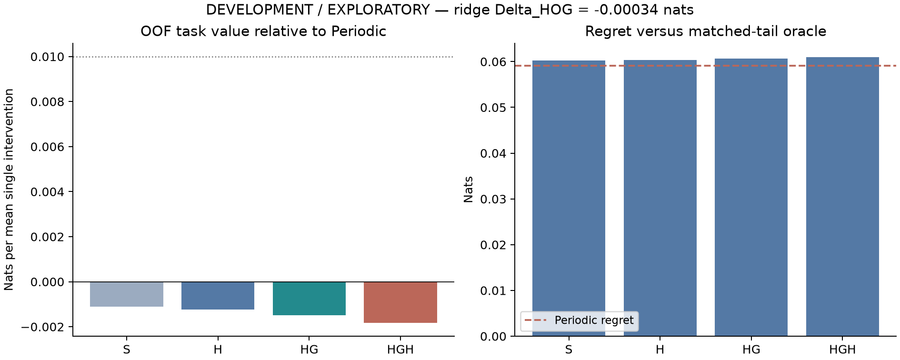
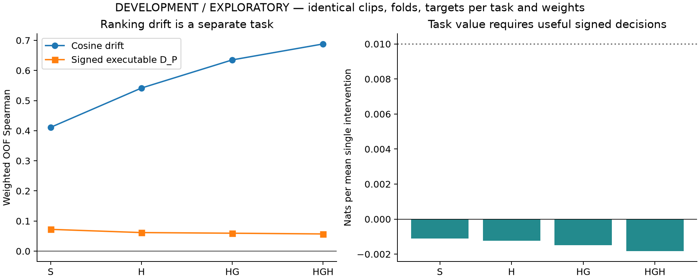
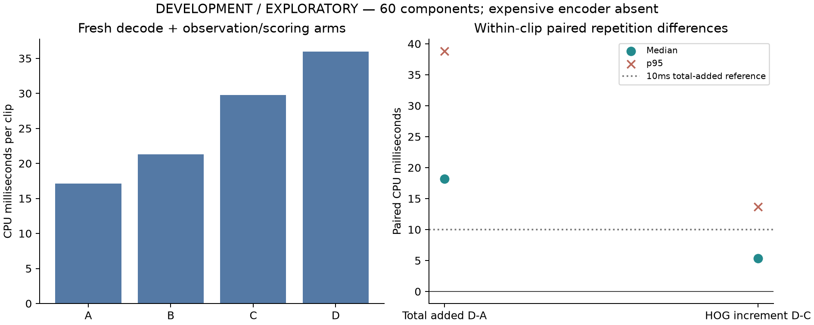

# Experiment26 — DEVELOPMENT / EXPLORATORY

Execution: **COMPLETE**. Research prioritization: **DEPRIORITIZE_THIS_CONFIGURATION**.

Primary RIDGE Delta_HOG=V(HGH)-V(HG): **-0.000335306 nats** per mean alternative single intervention. Favorable held-out folds: 2/5; effects [0.0020069383525475235, -0.0015155292310896425, 0.00100694943614279, -0.0004935256013233206, -0.0026159416574133587]. Practical reference .01 nats.

|View|Value, nats|Regret, nats|Top1 change, percentage points|D_P MAE|Spearman|AUROC|AP|
|---|---:|---:|---:|---:|---:|---:|---:|
|S|-0.001116660|0.060263140|-0.02058|0.138702|0.072298|0.538626|0.513933|
|H|-0.001245586|0.060392065|-0.02232|0.139031|0.061601|0.532795|0.513438|
|HG|-0.001493297|0.060639776|0.03384|0.139435|0.059485|0.530465|0.507850|
|HGH|-0.001828602|0.060975081|0.07684|0.139813|0.057032|0.530711|0.510409|

Periodic value=0; regret=0.059146479. Matched-tail label/future-privileged oracle value=0.059146479; regret=0 by construction.

Necessary ridge contrasts: H_minus_S=-0.000128926; HG_minus_H=-0.000247711; HGH_minus_HG=-0.000335306; HGH_minus_H=-0.000583016.

Shuffled held-out HOG value=-0.001420030; intact HGH=-0.001828602. This is an input-reliance check, not an independence test or p-value.

|View|Cosine-drift MAE|Cosine-drift Spearman|D_P Spearman|
|---|---:|---:|---:|
|S|0.050207|0.411149|0.072298|
|H|0.046078|0.541644|0.061601|
|HG|0.042565|0.635088|0.059485|
|HGH|0.039292|0.688036|0.057032|

Better drift ranking or AUROC alone is not task success. Drift is a separate offline target and never determines actions.

|Paired acquisition contrast|Median ms|p95 ms|
|---|---:|---:|
|D_minus_A_median_ms|18.179|38.832|
|D_minus_C_median_ms|5.328|13.665|
|C_minus_B_median_ms|8.847|18.982|
|B_minus_A_median_ms|4.532|8.494|

Costs use 60 clips/components, 31 classes, 480 warmup and 1200 measured trials. Paired repetitions collapsed within clip before median/p95. The 10 ms reference applies to median paired D-A. All trials freshly decode authentic bytes; OS file cache may be warm. Encoder absent; cached expensive anchor features/models supplied outside timers. Full decode/grid is common; observations access only endpoints available by each candidate. These are observation-path costs, not end-to-end adaptive runtime; nested components are not double counted.

Resource accounting: 3210 decode starts/3210 completions, 292799 frames; 80 completed CPU probe fits; 1860.55s elapsed; 40.72MiB retained at reporting. Zero new encoder forwards/GPU/head fits/controller fits/downloads.

Verification passed=True; historical files checked=4887. Actual initial HEAD is in checkout_audit.json; requested reference commit was not locally present, so the actual checkout was authoritative. Original roles/seals/19/19.1/23A/23B and untracked presentation work are preserved.

All 1,530 clips/478 global components/51 classes and 18,360 reset states are retained, including Dense-wrong clips and harms. Original head-training components are disjoint; unknown parent/reupload/pretraining links remain unresolved. Structural fields and much of historical H are deterministic at Periodic prefixes. Only cached probability/history summaries use frozen head arithmetic. Frozen ridge is primary regardless of the fixed tree sensitivity results in summary.json.

Finite-cohort retrospective cross-fitting does not restore untouched status. Overlapping training folds, probe/head fitting uncertainty, fixed head/classes/continuation, unknown dependencies and capacity/feature limitations preclude confirmation, equivalence, impossibility, significance or controller-gate claims. No bootstrap population confidence interval is supplied. Adverse tails, all fold/class/source results, signed bins and leave-one-component influence are retained.

Fresh confirmation: **BLOCKED_INPUT_FOR_CONFIRMATION**. Metadata-only gate finds 74 isolated official-unused clips across 24 classes, with unresolved original-parent and exposure certification. See fresh_confirmation_feasibility and prospective_experiment_26B_protocol.md. No fresh outcomes were opened.

Next research decision: Deprioritize this fixed HOG/CPU observation configuration; retain the adverse task/cost evidence and require a separately authenticated untouched population before independent confirmation.





Exact PowerShell commands (repository root):

```powershell
$env:OMP_NUM_THREADS="1"; $env:OPENBLAS_NUM_THREADS="1"; $env:MKL_NUM_THREADS="1"; $env:CUDA_VISIBLE_DEVICES=""
.\.venv_temporal\Scripts\python.exe -m unittest test_executable_value_observability -v
.\.venv_temporal\Scripts\python.exe run_executable_value_observability.py preflight --output results/executable_value_observability_v1
.\.venv_temporal\Scripts\python.exe run_executable_value_observability.py run --output results/executable_value_observability_v1
.\.venv_temporal\Scripts\python.exe run_executable_value_observability.py resume --output results/executable_value_observability_v1
.\.venv_temporal\Scripts\python.exe run_executable_value_observability.py verify --output results/executable_value_observability_v1
```

Final reporting checks:

All 596 Dense-wrong clips (weighted mass 42.3719%) remain included. Ridge HGH clip gain quantiles at probabilities [0,.01,.05,.5,.95,.99,1] are [-0.22102127257509174, -0.10182892109571366, -0.04472949504335536, -3.674396246363306e-05, 0.03947213353477016, 0.08139491626931816, 0.1993178351535637]; 832 clips have negative mean gain and 687 positive mean gain. Small/zero gains remain included.

Fixed-tree sensitivity: HGH-HG value difference -0.000466830 nats; HGH value -0.003713307. This does not change the ridge primary. Leave-one-component primary ridge contrast range [-0.000498362, -0.000025421] nats. Component maximum weight 0.011910; effective weighted component count 358.600. These are finite-cohort sensitivity summaries.

Timing arms: A = encoded-byte load/authentication + CPU decode/order/grid; B adds history/H ridge; C adds genuine grayscale/HG ridge; D adds HOG/HGH ridge. Nested component cost summaries are in timing_component_summary.json; raw loading/decode/grid/conversion/history/gray/HOG/scoring boundaries remain in timing_raw_trials.csv. Do not add nested medians. All three rendered PNG layouts were visually inspected; PDF plots use the same layout.
