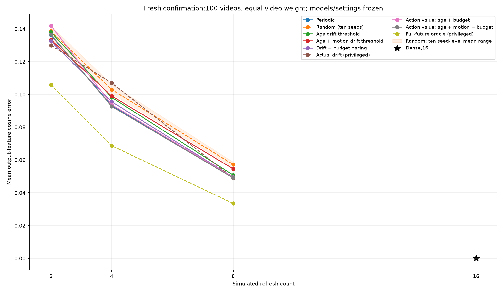
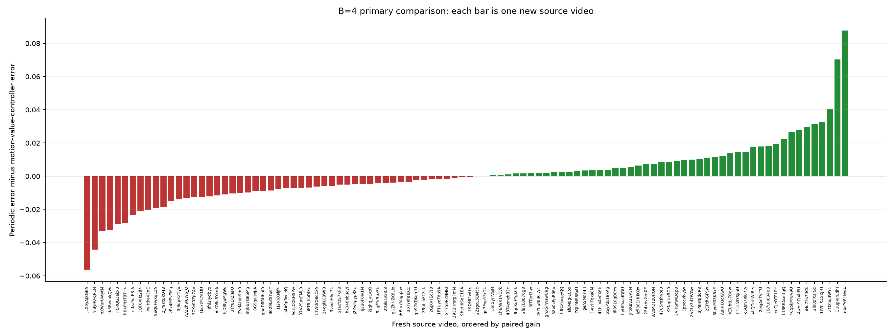
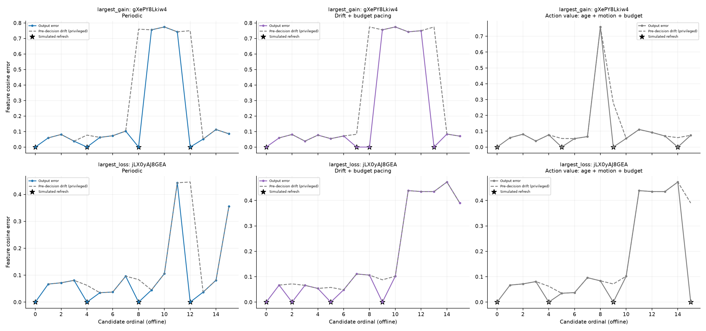

# Fresh-video confirmation of frozen budget-aware refresh

Written 2026-10-14T05:49:56.090357+00:00 (UTC). Primary result: **inconclusive; interval includes zero**.

## Cohort, reference collection and frozen methods

Exactly100 new source videos:five per frozen class across twenty existing classes. Frozen prior exclusions contained210 sources and210 hashes; this run conservatively adds113 prior inspected/collected source IDs and106 hashes. No source/hash overlap or duplicates remain. Selection and replacements used only predetermined archive/candidate rank and eligibility; no policy performance was examined before the complete manifest froze.
Verified cached compressed bytes 9,464,444,791; new reserved compressed bytes 7,518,909,221 (7.003 GiB), under12GiB. Observed response body transfer bytes 7,518,909,221; headers/metadata and retransmissions can differ from reservation. Archives/encoded videos remain local, unmodified.
Retained references:1,600. Actual ResNet18 forward entries:1628; extra smoke/retry calls:28. Collection uses the original verified weights, preprocessing, CUDA float32 batch1, eval/inference mode, numerical settings, software decoder and per-frame CPU motion descriptors. Missing vectors do not disqualify clips. Reference collection is actual encoder work; policy replay performs **zero encoder calls**.

Frozen coefficient/scaler and selected-setting digests matched before acquisition and after evaluation. No regressors/scalers were refitted, no grids recalculated, no thresholds/lambdas/features changed. Original forty-video compatibility reproduced all1120 policy/budget metrics and2200 schedules. Replay uses all nine sparse methods at2,4,8 and dense16; all ten random seeds are averaged within each source before aggregating sources.

## Primary and predefined secondary comparisons

Positive differences favor the candidate. Intervals use the same10,000x100 resampling matrix of whole source videos, PCG64 seed20261014 and linear percentiles. Secondary intervals are marginal and unadjusted.

| B | Candidate | Reference | Mean paired gain |95% interval|Improved/tied/worsened|Mean per-video gain (%)|Status|
|---:|---|---|---:|---|---|---:|---|
|2|Action value: age + budget|Periodic|-0.005921|[-0.012443,+0.001455]|35/0/65|-7.12|inconclusive; interval includes zero (secondary)|
|2|Action value: age + motion + budget|Drift + budget pacing|-0.004116|[-0.011276,+0.003171]|41/0/59|-8.19|inconclusive; interval includes zero (secondary)|
|2|Action value: age + motion + budget|Periodic|-0.000476|[-0.006610,+0.006631]|41/2/57|-4.30|inconclusive; interval includes zero (secondary)|
|2|Action value: age + motion + budget|Action value: age + budget|+0.005445|[+0.002420,+0.008984]|40/43/17|2.13|lower error evidence (secondary)|
|4|Action value: age + budget|Periodic|-0.000490|[-0.003904,+0.003256]|44/0/56|-3.19|inconclusive; interval includes zero (secondary)|
|4|Action value: age + motion + budget|Drift + budget pacing|+0.002884|[-0.002206,+0.008260]|53/1/46|0.27|inconclusive; interval includes zero (secondary)|
|4|Action value: age + motion + budget|Periodic|+0.000550|[-0.003083,+0.004406]|48/0/52|-1.90|inconclusive; interval includes zero (PRIMARY)|
|4|Action value: age + motion + budget|Action value: age + budget|+0.001039|[-0.000327,+0.002415]|28/50/22|1.10|inconclusive; interval includes zero (secondary)|
|8|Action value: age + budget|Periodic|-0.000280|[-0.001131,+0.000657]|12/70/18|-0.65|inconclusive; interval includes zero (secondary)|
|8|Action value: age + motion + budget|Drift + budget pacing|+0.000462|[-0.002062,+0.003032]|52/1/47|-6.27|inconclusive; interval includes zero (secondary)|
|8|Action value: age + motion + budget|Periodic|+0.000102|[-0.001339,+0.001626]|43/11/46|-0.54|inconclusive; interval includes zero (secondary)|
|8|Action value: age + motion + budget|Action value: age + budget|+0.000381|[-0.001185,+0.002068]|42/15/43|-0.22|inconclusive; interval includes zero (secondary)|

## Fresh-test feature error

|Policy|B2 mean|B4 mean|B4 median per-video|B8 mean|
|---|---:|---:|---:|---:|
|Periodic|0.136025|0.093144|0.088644|0.049118|
|Random (ten seeds)|0.138597|0.102911|0.102261|0.057151|
|Age drift threshold|0.137984|0.098075|0.088530|0.050721|
|Age + motion drift threshold|0.133327|0.098946|0.088063|0.054554|
|Drift + budget pacing|0.132385|0.095479|0.085520|0.049479|
|Actual drift (privileged)|0.129922|0.106933|0.106844|0.048991|
|Action value: age + budget|0.141946|0.093634|0.090384|0.049398|
|Action value: age + motion + budget|0.136501|0.092595|0.088634|0.049017|
|Full-future oracle (privileged)|0.105831|0.068600|0.061194|0.033455|

Dense B16 mean error:3.386e-17. Actual drift threshold and full-future oracle are privileged diagnostics, not efficient deployable methods.

## Development results, shown separately

|Policy|Development B4 mean|Fresh B4 mean|
|---|---:|---:|
|Periodic|0.098383|0.093144|
|Drift + budget pacing|0.100075|0.095479|
|Action value: age + budget|0.095387|0.093634|
|Action value: age + motion + budget|0.096393|0.092595|

Development and fresh results are not pooled. A positive development point estimate does not override an inconclusive or negative primary fresh interval.

## Does motion add value, and does the controller beat pacing?

B2 motion value versus Action value: age + budget: lower error evidence; paired gain+0.005445, interval[+0.002420,+0.008984].
B2 motion value versus Drift + budget pacing: inconclusive; interval includes zero; paired gain-0.004116, interval[-0.011276,+0.003171].
B4 motion value versus Action value: age + budget: inconclusive; interval includes zero; paired gain+0.001039, interval[-0.000327,+0.002415].
B4 motion value versus Drift + budget pacing: inconclusive; interval includes zero; paired gain+0.002884, interval[-0.002206,+0.008260].
B8 motion value versus Action value: age + budget: inconclusive; interval includes zero; paired gain+0.000381, interval[-0.001185,+0.002068].
B8 motion value versus Drift + budget pacing: inconclusive; interval includes zero; paired gain+0.000462, interval[-0.002062,+0.003032].

## Distribution, oracle headroom and schedules

Primary improvements occur in48/100 videos, ties0, losses52; 7/20 classes improve descriptively. Top-two-positive-gains share of positive net summed gain:287.48%; defined: net sum positive; can exceed100% when losses offset gains. No class significance claims are made from five videos/class.

Percentages computed from aggregate means are saved separately from mean per-video percentages. Oracle-gap ratios can be negative despite a positive absolute average gain; small denominators amplify losses. Undefined denominators remain null/blank with reasons.

|B|Mean oracle headroom|Motion value mean oracle-gap closure (%)|Undefined gaps|Motion value mean forced refreshes|Mean last refresh|Mean outputs after exhaustion|
|---:|---:|---:|---:|---:|---:|---:|
|2|0.030193|-96.65|8|0.01|11.71|3.29|
|4|0.024544|-33.53|0|0.15|14.01|0.99|
|8|0.015663|-13.10|0|0.83|14.78|0.22|

Random-seed variability is separate descriptive variability; seeds are not independently bootstrapped videos. All bootstrap comparisons retain whole-video pairing. Action regrets and saved traces reproduce mean-error excess above the exact oracle. Low forced counts alone do not imply good fidelity.

## Interpretation and next action

The primary confirmation is inconclusive:the interval includes zero. This is neither confirmed improvement nor equivalence. Do not add more videos to this cohort until the interval becomes favorable.
Motion has not demonstrated an improvement beyond the corresponding age/budget controller in the primary-budget comparison; its extra complexity and potential processing cost are not justified by this confirmation.

Secondary outcomes across budgets remain visible above; favorable isolated comparisons do not establish broad superiority. No model redesign or retuning was performed.

## Limits

Appearance fidelity is not recognition accuracy. Reference-collection elapsed time is not adaptive inference latency. Replay refresh counts are simulated; no measured adaptive speedup is established. Full-clip candidates and future-reference codec vectors keep this offline. Test videos are new sources from existing classes, not unseen classes. The intervals condition on fixed fitted models and the sampled class population, exclude training uncertainty, and resample whole sources rather than candidates, frames, states or random seeds.

## Figures and reproduction








```powershell
& .\.venv\Scripts\python.exe .\run_fresh_refresh_confirmation.py --frozen-run results/budget_aware_refresh_v2 --output results/fresh_refresh_confirmation_v1 --device cuda --max-download-gib 12 --download-workers 8
```

For an incomplete run, append `--resume` with exactly the same configuration. Completed runs are audited/reproduced without acquiring another cohort. See verification.json, frozen identities, execution/sampling plans, acquisition/retry records and bootstrap_intervals.json.
