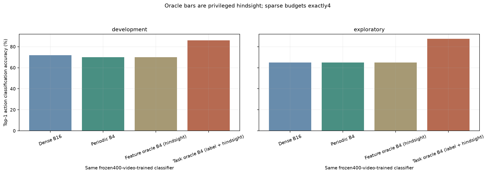

# recognition_baseline_v2

Status: complete; primary 400-video classifier predefined. 100 development and 40 previously used exploratory videos are separate.

See [findings](findings.md), [protocol](protocol.json), [learning curve](learning_curve.json), [metrics](aggregate_metrics.json), [intervals](bootstrap_intervals.json), [verification](verification.json).

```powershell
& .\.venv\Scripts\python.exe -m unittest test_recognition_baseline_v2 -v
& .\.venv\Scripts\python.exe .\run_recognition_baseline_v2.py --preflight-only --max-download-gib 20
& .\.venv\Scripts\python.exe .\run_recognition_baseline_v2.py --resume --max-download-gib 20 --download-workers 8
& .\.venv\Scripts\python.exe .\run_recognition_baseline_v2.py --audit-only
& .\.venv\Scripts\python.exe .\validate_release.py
```



