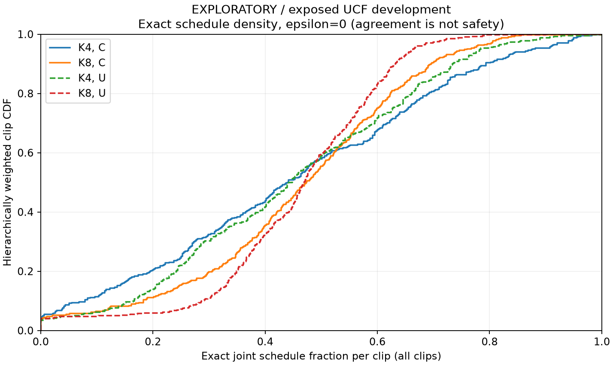
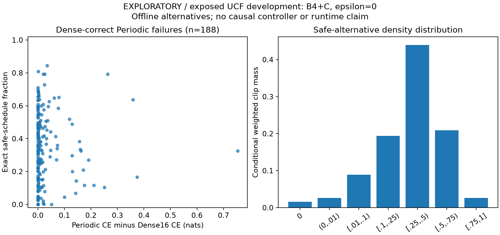

# safe_schedule_density_v1: completed exposed-development findings

All **400 predeclared execution clips / 200 class-group units / 101 classes**
were processed after the sealed, input-hash-selected 20-clip technical pilot.
These are already exposed UCF101 official-training members. Experiment 23A
**NO_GO / BLOCKED_INPUT** and frozen, unexecuted 23B remain unchanged. No new
controller fitting is justified by this diagnostic alone.

Every figure below is exploratory and descriptive. Percentages use equal-class,
equal-group-within-class, equal-clip weights. The primary rule is B4+C,
epsilon0, with separate numerical tolerance 1e-10. Single-clip fractions are
exact under enumeration of 455 schedules; K8 has 6,435 schedules. Schedules are
not independent observations.

1. **Are acceptable schedules widespread or sparse?** Densities are substantial
   but heterogeneous in this cohort. The all-clip mean joint density is **44.61%**
   (95% marginal group-bootstrap interval **42.75–46.53%**). On Dense-correct clips,
   conditional P_safe averages **46.71%** (44.99–48.52%). In the whole cohort,
   75.50% of weighted clip mass has joint density at least .25; 11.39% has density
   below .10, including 16 clips with no passing schedule (3.96% weighted mass).
   This is a distribution/density finding, not a new best-subset-headroom claim.

2. **Is Periodic already adequate?** It remains a strong accuracy baseline:
   **94.31%** weighted top1, compared with Dense16's **93.56%**. It meets the strict
   correctness-plus-CE rule on **47.52%** of weighted clips. That does not establish
   a general guarantee of task preservation. Many strict failures involve small
   CE changes: with epsilon .01/.05, Periodic joint success is **76.98% / 88.12%**.
   The strict rule and the chosen loss slack materially affect adequacy; a small
   CE increase is not automatically an important classification failure.

3. **Where Periodic fails, how dense are alternatives?** Among Dense-correct
   clips, 188 clips in 139 groups fail Periodic's primary joint rule, representing
   **47.28%** of whole-cohort weight. Of that conditional mass, **98.43%**
   (97.80–99.00%) has a passing same-budget schedule: 185 clips. Three clips have
   none (**1.57%** conditional weight). Exact safe density, including those zeros,
   averages **34.61%** (32.82–36.49%), with weighted median **33.41%**, quartiles
   **18.24–48.79%**, and range **0–84.40%**. The whole-cohort mass of Dense-correct,
   rescuable Periodic failures is **46.53%** (43.07–50.00%). These are offline
   label-informed alternatives, without an identified causal decision rule.

4. **Do frozen H/H+M miss those alternatives?** Yes. Under the same B4+C primary
   rule, missed_safe whole-cohort mass is **48.27%** for H (45.05–51.73%) and
   **48.02%** for H+M (44.55–51.73%): respectively 192 clips/146 groups and
   190 clips/143 groups. On the Dense-correct stratum, each misses alternatives on
   **48.94%** of its conditional weighted clip mass. Their whole-cohort joint
   success is **47.77% / 48.02%**, versus Periodic **47.52%**; this descriptive
   endpoint does not establish an H+M advantage. Archived executed comparisons
   apply only to **B4+C**. U is offline re-pooling; K8 H/H+M execution is **N/A**.

5. **What remains unknown?** Exact retrospective density does not establish
   pre-decision causal information, reliable selection without labels/future
   embeddings, generalization to an untouched population, or complete execution
   runtime. Head development selection, the historical fit iteration limit,
   overlapping head/controller training and unresolved parent/reupload/pretraining
   relationships remain limitations. BenchPress and JavelinThrow have one group
   each and no within-class bootstrap variance. The remaining classes have only
   two groups each. No fresh-population or complete-runtime gate is cleared.

The predeclared loss-slack sensitivities are:

|B4+C epsilon (nats)|All-clip mean joint density|Periodic joint success|Whole-cohort Dense-correct Periodic failure mass|
|---:|---:|---:|---:|
|0|44.61%|47.52%|47.28%|
|.01|75.92%|76.98%|17.82%|
|.05|84.06%|88.12%|6.68%|

At epsilon0, C/K8 mean joint density is 45.76%; U/K4 is 44.61% and U/K8
45.65%. No clipwise K8>=K4 safety constraint was imposed. All sensitivities
remain in the saved tables, without selecting a favorable pool or budget.
RandomExact B4+C correctness is 92.83%, the mean of individual schedule
correctness. Its CE is likewise a mean of individual losses, not ensemble loss.
The fixed descriptive fraction improving Periodic CE by at least .01 nats
without losing Periodic correctness averages **18.16%** (16.16–20.16%).

All 26 Dense-wrong clips remain in the population summaries. On that stratum,
B4+C epsilon0 correction density is **14.61%**, CE-preservation density **53.72%**,
and their intersection **14.16%**; conditional P_safe is **N/A**. Dense agreement
there is **70.22%**, explicitly fidelity to an incorrect prediction, not task
safety. The complete four-cell correctness-transition tables are saved.

The 2,000 paired class-stratified group-bootstrap draws use PCG64 seed20261021
and preserve all method/pool/budget/epsilon pairings. Intervals are marginal,
unadjusted and conditional on the exposed cohort and reused head. The technical
pilot has no population intervals and is separately sealed PARTIAL_PILOT.

Authentication and verification reproduced archived full-precision Periodic CE
0.24742722945956003, Dense16 CE 0.24432429514344095 and B4 task-oracle CE
0.13548268541350716. Maximum per-clip archive discrepancy is 3.55e-14 nats.
Independent raw-feature scalar pooling agrees within 1.78e-15 nats on the fixed
real-clip/schedule checks. An independent verifier reconstructed all 4,800 rows,
1,600 exact distributions and 900 estimates/intervals, including the oracle mean
from actual stored schedule minima. Historical scientific files remain unchanged.

New encoder calls=**0**; fits=**0**; decodes=**0**; downloads=**0**; GPU
initializations=**0**. Full enumeration/reporting took 111.62 seconds in its
recorded CPU invocation, excluding input preflight. This is diagnostic wall time,
**not inference latency**.

See [commands and artifact inventory](README.md), [frozen protocol](protocol.md),
[full stage findings](full/findings.md), [independent verification](independent_verification.json)
and [full verification](full/verification.json).

