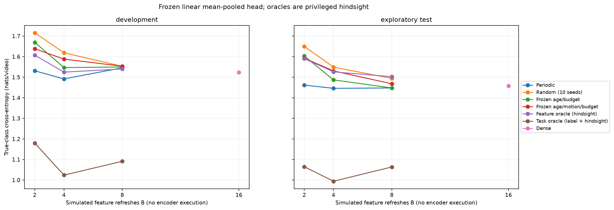

# Task-aware oracle v1

Status: completed after verification; decision **CONTINUE**. 80 training,40 development,40 exploratory test videos; fresh confirmation excluded.

See [findings](findings.md), [classifier quality](classifier_metrics.json), [per-video metrics](per_video_metrics.csv), [oracle schedules](oracle_schedules.json), [paired intervals](bootstrap_intervals.json), [verification](verification.json), [head parameters](classifier_parameters.json) and [configuration](model_configuration.json). Reproduction commands are in findings; full refitting requires the original small annotation CSV, audit requires no video assets.

Task oracle is privileged and label-aware. No deployable accuracy or latency improvement is claimed.
